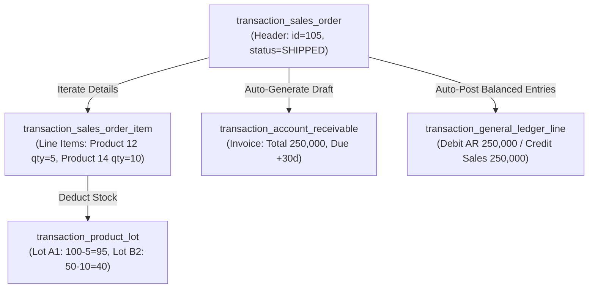

<div align="center">

# Flexurio No‑Code API Engine

**Declarative, database‑driven REST endpoints generated from JSON configuration.**

Ship full CRUD plus advanced data operations (GET / POST / PUT / DELETE / PATCH / TRACE, import & export) for any table — without writing boilerplate code. Built with Rust + Actix Web.

`flx-nocode-api` · supports MySQL · PostgreSQL · SQLite · MSSQL · MongoDB

</div>

---

## Table of Contents

1. [What is Flexurio?](#1-what-is-flexurio)
2. [How it works](#2-how-it-works)
3. [Quick start (SQLite)](#3-quick-start-sqlite)
4. [Installation](#4-installation)
5. [Environment variables (`.env`)](#5-environment-variables-env)
6. [Configuration layout (`LOC_CONFIG`)](#6-configuration-layout-loc_config)
7. [Entity schema reference](#7-entity-schema-reference)
8. [Custom ID generation (`function`)](#8-custom-id-generation-function)
9. [Master‑Detail (Header‑Detail) transactional orchestration](#9-master-detail-header-detail-transactional-orchestration)
10. [Declarative Action Triggers & ERP Cascading Workflows (`action_triggers`)](#10-declarative-action-triggers--erp-cascading-workflows-action_triggers)
11. [Document Immutability & State Machine Governance (`locked_when` & `state_machine`)](#11-document-immutability--state-machine-governance-locked_when--state_machine)
    - 11b. [Scheduled jobs & time-based workflows (`schedules`)](#11b-scheduled-jobs--time-based-workflows-schedules)
    - 11c. [Structured Audit Trail (`audit_trail` & `GET /audit_trail`)](#11c-structured-audit-trail-audit_trail--get-audit_trail)
12. [Database seeding (`seed`)](#12-database-seeding-seed)
13. [Hooks & validation](#13-hooks--validation)
14. [Formula placeholders](#14-formula-placeholders)
15. [Endpoint reference](#15-endpoint-reference)
16. [Authentication & authorization](#16-authentication--authorization)
17. [Import & export](#17-import--export)
18. [MCP server (Model Context Protocol)](#18-mcp-server-model-context-protocol)
19. [Column encryption](#19-column-encryption)
20. [Logging & observability](#20-logging--observability)
21. [Database feature flags (compile‑time)](#21-database-feature-flags-compile-time)
22. [Multi‑target build script (`build.sh`)](#22-multi-target-build-script-buildsh)
23. [Troubleshooting](#23-troubleshooting)
24. [Security checklist](#24-security-checklist)
25. [Contributing & license](#25-contributing--license)

---

## 1. What is Flexurio?

Flexurio No‑Code API lets you stand up secure, multi‑database REST endpoints by **describing each entity (table) in a JSON file**. You write configuration, not code; the engine generates the HTTP surface, validates requests, talks to the database, and enforces authentication.

Typical use cases:

* Rapid prototyping of admin / data panels.
* Internal tooling and back‑office APIs.
* Putting a clean REST API over an existing MySQL / Postgres / SQLite / MSSQL / MongoDB database.
* Computed / formula‑driven flows and change‑capture journaling (PATCH & TRACE).

---

## 2. How it works

At startup the engine:

1. Reads the active config profile path from the `LOC_CONFIG` environment variable.
2. Loads enabled route names from `LOC_CONFIG/routes.json`.
3. Loads one entity schema per route from `LOC_CONFIG/entity/<route>.json`.
4. Ensures the core tables (`flx_users`, `flx_roles`) exist and seeds a default admin if none exists.
5. Registers a uniform REST surface for every route (only the HTTP methods you enable per schema).
6. Applies JWT authentication to all non‑public routes (with public overrides and an optional IP allow‑list).

```
                ┌────────────────────┐
   routes.json  │  enabled routes    │
                └─────────┬──────────┘
                          │  for each route
                          ▼
        LOC_CONFIG/entity/<route>.json  ──►  TableSchema
                          │
                          ▼
   ┌──────────────────────────────────────────────────────────┐
   │  Actix‑web router                                          │
   │   GET /<route>     POST /<route>    PUT /<route>/{id}      │
   │   DELETE /<route>/{id}   PATCH /<route>   TRACE /<route>   │
   │   POST /import/<route>   GET /export/<route>               │
   │   GET /validate/<route>  POST /generate/table/<route>      │
   └──────────────────────────────────────────────────────────┘
                          │
                          ▼
        DB adapter (MySQL · Postgres · SQLite · MSSQL · MongoDB)
```

---

## 3. Quick start (SQLite)

The fastest way to try Flexurio — no external database needed.

```bash
# 1. Get a binary (build from source shown here; see §4 for installers)
cargo build --release

# 2. Create a minimal .env
cat > .env <<'EOF'
DB_TYPE=sqlite
SQLITE_URL=sqlite://data.db
LOC_CONFIG=config
SECRET_KEY=replace_with_a_long_random_secret
ENCRYPT_KEY=replace_with_another_random_secret
PORT=8080
REQUIRE_AUTH=True
DEBUG=True
LOGGING=True
EOF

# 3. Run it
./target/release/flx-nocode-api
```

On first start the engine creates `flx_users` / `flx_roles` if missing and, if there is no admin yet, prints a generated password to the console:

```
Your admin Password: 1234
```

Log in with email `admin` and that password (see [§16](#16-authentication--authorization)).

---

## 4. Installation

### Requirements

* macOS or Linux (Windows works natively or via WSL).
* A database. SQLite needs nothing extra and is ideal for a first run.
* Rust toolchain **only** if you build from source.

### 4.1 Installer script (macOS / Linux)

```bash
curl -fsSL https://raw.githubusercontent.com/flexurio/flx-nocode-api/main/install-flexurio.sh | bash
```

The script detects your OS/architecture, downloads the matching asset from the latest GitHub release, installs the binary plus a convenient `flexurio` wrapper into `~/.local/bin`, and adds it to your `PATH`. The `flexurio` command automatically reads the `.env` in the current working directory.

Reload your shell afterwards (e.g. `source ~/.zshrc`), then run `flexurio` from any folder containing a `.env`.

### 4.2 Windows

```powershell
Set-ExecutionPolicy -Scope Process -ExecutionPolicy Bypass
.\install-flexurio.ps1
# open a new terminal, then:
flexurio
```

### 4.3 Manual download (latest release)

```bash
# macOS (Apple Silicon)
curl -fsSL -o flx-nocode-aarch64-apple-darwin.pkg \
  https://github.com/flexurio/flx-nocode-api/releases/latest/download/flx-nocode-aarch64-apple-darwin.pkg
sudo installer -pkg flx-nocode-aarch64-apple-darwin.pkg -target /

# Linux (x86_64)
curl -fsSL -o flx-nocode-x86_64-unknown-linux-gnu \
  https://github.com/flexurio/flx-nocode-api/releases/latest/download/flx-nocode-x86_64-unknown-linux-gnu
chmod +x flx-nocode-x86_64-unknown-linux-gnu
install -m 0755 flx-nocode-x86_64-unknown-linux-gnu "$HOME/.local/bin/flx-nocode"
```

### 4.4 Build from source

```bash
git clone https://github.com/flexurio/flx-nocode-api.git
cd flx-nocode-api
cargo build --release
./target/release/flx-nocode-api
```

To build a smaller binary with only the database backend(s) you need, see [§21](#21-database-feature-flags-compile-time).

### 4.5 Docker

`docker-compose.yaml` is included as a reference. Mount your `static/`, `config/`, and `.env`:

```yaml
services:
  rust-app:
    build: .
    container_name: flx-nocode-api
    restart: always
    ports:
      - "2121:8080"        # access at http://localhost:2121
    volumes:
      - "./static:/app/static"
      - "./config:/app/config"
      - "./.env:/app/.env"
```

---

## 5. Environment variables (`.env`)

Copy the bundled example and edit it:

```bash
cp env .env
```

> Pick exactly one `DB_TYPE` and its matching URL. Avoid duplicate keys.

### Core

| Variable | Required | Description |
|----------|----------|-------------|
| `PORT` | Yes | HTTP listen port (e.g. `8080`). |
| `DB_TYPE` | Yes | One of `mysql`, `postgres`, `sqlite`, `mssql`, `mongodb`. |
| `MYSQL_URL` / `POSTGRES_URL` / `SQLITE_URL` / `MSSQL_URL` / `MONGODB_URI` | Cond. | Connection string for the selected backend. SQLite quick start: `sqlite://data.db`. |
| `MONGODB_DB` | Cond. | Database name when `DB_TYPE=mongodb`. |
| `SECRET_KEY` | Yes | HMAC secret used to sign Flexurio‑issued JWTs. |
| `ENCRYPT_KEY` | Yes | Symmetric key for encrypted columns (`encrypt: true`). |
| `LOC_CONFIG` | Yes | Path to the active config profile (contains `routes.json` + `entity/`). |
| `REQUIRE_AUTH` | No | `True` (default) to enforce JWT auth; `False` exposes routes without auth. |
| `BASE_URL` | No | External base URL used in logs / links. |

### Locations

| Variable | Default | Description |
|----------|---------|-------------|
| `LOC_STATIC` | `static` | Directory served under `/static`. |
| `LOC_IMAGE` | `images` | Image upload directory (inside the static directory). |
| `LOC_LOGGING` | `logs` | Directory for log files. |
| `LOC_AUDIT` | — | Path to the audit event log (keep outside `static/` to avoid exposing it). |
| `LOC_SEED` | `seed` | Directory containing seed data files (`.json`, `.csv`, `.sql`). |

### Authorization & external JWT (converter token)

| Variable | Description |
|----------|-------------|
| `CUSTOME_JWT_QUERY` | SQL run at login to enrich the JWT `cs` claim. Use `{:?}` as the user‑id placeholder, e.g. `SELECT email FROM flx_users WHERE id = {:?}`. (`CUSTOM_JWT_QUERY` is also accepted.) |
| `WHITE_LIST_IP` | Comma‑separated IPs / CIDR ranges that bypass JWT validation. |
| `CONVERTER_JWT_SECRET` | HMAC secret to verify externally‑issued JWTs (converter‑token mode). |
| `CONVERTER_JWT_PUBLIC_KEY` | PEM public key (RS*/ES*/EdDSA) to verify external JWTs. Use literal `\n` for newlines. |
| `CONVERTER_JWT_ALG` | Algorithm for external JWT verification (e.g. `HS256`, `RS256`). |
| `CONVERTER_JWT_ISSUER` / `CONVERTER_JWT_AUDIENCE` | Optional issuer / audience claim checks (comma‑separated). |
| `CONVERTER_JWT_INSECURE_SKIP_VERIFY` | `true` to accept external JWTs **without** signature verification (only if an upstream gateway already validates them). |

> Converter‑token mode is **fail‑closed**: if it is active and none of the verification variables are set, all converter‑token requests are rejected. See [§16](#16-authentication--authorization).

### Limits, uploads & rate limiting

| Variable | Default | Description |
|----------|---------|-------------|
| `LIMIT_DEFAULT` | `100` | Default page size for `GET`. |
| `LIMIT_MAX` | `1000` | Maximum page size a client may request. |
| `JSON_LIMIT_KB` | `512` | Max JSON request body size. |
| `UPLOAD_LIMIT_MB` | `5` | Max upload size per file. |
| `UPLOAD_TEXT_LIMIT_KB` | `512` | Max size of a text form field. |
| `UPLOAD_MAX_FILES` / `UPLOAD_MAX_FIELDS` | `5` / `100` | Multipart limits. |
| `UPLOAD_EXT_ALLOW` | — | Comma‑separated allow‑list of upload file extensions. |
| `IMPORT_BATCH_SIZE` | — | Rows per batch during import. |
| `RATE_LIMIT_LOGIN_PER_MIN` | `3` | Login attempts per minute. |
| `RATE_LIMIT_MUTATE_PER_SEC` | `20` | Per‑second limit for mutating methods. |
| `RATE_LIMIT_GET_PER_SEC` | `50` | Per‑second limit for `GET`. |
| `RATE_LIMIT_MCP_PER_SEC` | `30` | Per‑second limit for the MCP endpoint (see [§18](#18-mcp-server-model-context-protocol)). |
| `RATE_LIMIT_LOGIN_FAIL_USER` / `RATE_LIMIT_LOGIN_FAIL_IP` | — | Failed‑login limits over a 5‑minute window. |

### Performance & server tuning

| Variable | Description |
|----------|-------------|
| `ACTIX_WORKERS` | Number of worker threads (match CPU cores). |
| `HTTP_KEEPALIVE_SECS` / `HTTP_BACKLOG` / `HTTP_MAX_CONN_RATE` / `HTTP_MAX_CONNECTIONS` | HTTP server tuning. |
| `MAX_POOL` / `MIN_POOL` / `CONNECT_TIMEOUT` / `POOL_MAX_LIFETIME_SECS` / `POOL_IDLE_TIMEOUT_SECS` | DB connection‑pool tuning. Defaults: `MAX_POOL = clamp(cpu*2+4, 8..64)`, `MIN_POOL = clamp(cpu, 2..16)`, `CONNECT_TIMEOUT = 5` s (fail fast). |
| `DB_STATEMENT_TIMEOUT_MS` / `DB_QUERY_TIMEOUT_SECS` | Server‑side statement/lock timeout applied per connection (default 30 000 ms) and client‑side safety net (default statement + 5 s). A runaway query returns an error instead of pinning a connection. |
| `ENABLE_COMPRESSION` | Response compression (gzip/br/zstd). **On by default**; set `false` behind a proxy that already compresses. File downloads are never compressed twice. |
| `ROUTE_VERSION_REFRESH_MS` | How often readers re-check the per‑route cache version in Redis (default 1000). Bounds cross‑replica cache staleness after a write. |
| `WRITE_QUEUE_ENABLED` / `WRITE_CONCURRENCY` / `WRITE_QUEUE_MAX_LEN` / `WRITE_EXEC_RETRY_MAX` | Write‑queue / concurrency controls for high write throughput. |
| `DEFAULT_COLLATE` | Default collation for MySQL/MariaDB (e.g. `utf8mb4_bin`). |
| `MSSQL_ENCRYPTION` / `MSSQL_TRUST_CERT` | TLS options for MSSQL. |
| `REDIS_HOST` / `REDIS_PORT` / `REDIS_PASSWORD` / `REDIS_DB` | Redis connection (caching / extension). |
| `SCHEDULER_ENABLED` / `SCHEDULER_TICK_SECS` / `SCHEDULER_CATCH_UP_SECS` / `SCHEDULER_LOCK_TTL_SECS` / `SCHEDULER_MAX_ROWS` | Built-in cron scheduler (default on, 15 s tick, 1 h catch-up, 900 s lease, 10 000 rows/run). See [§11b](#11b-scheduled-jobs--time-based-workflows-schedules). |

### Logging & observability

| Variable | Description |
|----------|-------------|
| `RUST_LOG` | `tracing` filter (default `info`). One access line per request is emitted under target `flx::access`; `RUST_LOG=info,flx::access=warn` silences it. |
| `LOG_FORMAT` | `json` emits one JSON object per line (for Loki/ELK/CloudWatch); default is compact text. |
| `DEBUG` | `1`/`true`/`yes` enables verbose debug logging. |
| `LOGGING` | `True` enables extended log output to `LOC_LOGGING`. |
| `LOG_MIN_LEVEL` | `error\|warn\|info\|debug\|trace` (default `info`). Drops messages below the level. |
| `LOG_MAX_BODY_BYTES` | Max bytes printed per log body (default `8192`); longer bodies are truncated. |
| `LOG_SAMPLE_DEBUG_N` | Sample every N debug/trace logs (default `1` = no sampling). |
| `LOG_QUEUE_CAP` | Bounded logger queue capacity (default `2048`). |
| `LOG_COLOR` | `0`/`false`/`no` disables ANSI colors. |

Logging runs on a non‑blocking background thread, so it never blocks the request path. In production prefer `LOG_MIN_LEVEL=info` (most SQL/param logs are at `debug`) and consider sampling under high load.

Every response carries an `x-request-id` header (propagated from the request when the client sends one) so a log line, a client error and a trace can be correlated.

`GET /metrics` (Prometheus text format) exposes, besides the counters:

| Metric | Labels | Meaning |
|--------|--------|---------|
| `flx_http_request_duration_seconds` (histogram) | `route`, `method`, `status` | End‑to‑end latency per entity route. Unknown first path segments are folded into `route="other"`. |
| `flx_db_query_duration_seconds` (histogram) | `kind` = `query`, `begin`, `tx_query`, `tx_execute`, `commit`, `rollback` | Time spent in the database driver. |
| `flx_db_pool_size` / `flx_db_pool_idle` / `flx_db_pool_active` / `flx_db_pool_max` | — | Connection pool occupancy. |
| `flx_db_timeouts` | — | Statements aborted by the client‑side timeout. |
| `flx_cache_hits` / `flx_cache_misses` | — | GET pages served from L1/L2 vs. the database. |

Cached GET responses also return an `ETag`; a request with a matching `If-None-Match` gets `304 Not Modified` without touching cache or database. Load‑test scenarios with latency thresholds live in [`perf/`](perf/README.md).

---

## 5b. Operations: offline init, hot reload, queues, webhooks, tokens

### Offline install

```bash
flx-nocode-api init            # writes .env (random keys), config/{routes,rules}.json, config/entity/flx_*.json, static/, seed/
flx-nocode-api                 # start
```

The server never downloads anything at boot: the core entities are compiled into the binary and written to `LOC_CONFIG` when missing.

### Hot reload (no restart)

Edit or add entity files under `LOC_CONFIG/entity`, list them in `routes.json`, then:

```bash
curl -X POST -H "Authorization: Bearer <admin jwt>" http://localhost:8080/admin/reload
# or
kill -HUP $(pidof flx-nocode-api)
```

The reload re-reads the directory, runs the configuration lint, creates tables/indexes for **new or changed** entities (`CREATE … IF NOT EXISTS`; existing columns are never altered), swaps the in-memory registry atomically and drops every cached page. A rejected reload (`422`) leaves the running configuration untouched. `GET /admin/registry` shows the live generation. Admins are users whose JWT roles match `ADMIN_ROLES` (default `admin,Super Admin,Administrator,flx_roles`) or user id `1`.

### Queues on Redis Streams

`WRITE_QUEUE_ENABLED` and `EMAIL_CONSUMER_ENABLED` now use Redis Streams with consumer groups: every job is delivered to one consumer, acknowledged with `XACK` only after it is applied (or dead-lettered), and jobs of a crashed worker are re-delivered by `XAUTOCLAIM` after `WRITE_CLAIM_IDLE_MS`. Lag is exported as `flx_write_queue_len`, `flx_write_queue_pending`, `flx_email_queue_*`. Jobs still sitting in the pre-Streams lists are migrated at boot.

### Webhooks via transactional outbox

```json
"webhooks": [
  { "event": "on_create", "url": "https://erp.example.com/hooks/so", "headers": { "X-Hook-Secret": "..." } }
]
```

`event` is `on_create`, `on_update`, `on_delete` or `*`. The event row is written to `flx_outbox` **in the same transaction** as the record, so it exists exactly when the write committed; a background worker POSTs `{event, entity, table, id, actor_id, at, record, old_record}` with exponential backoff (`OUTBOX_MAX_ATTEMPTS`, then `status = failed`). The user's request never waits for the receiver. Metrics: `flx_outbox_pending`, `flx_outbox_sent`, `flx_outbox_failed`.

### Access + refresh tokens, revocation

`POST /login` returns the access token in `data` (unchanged) and a refresh token in the `X-Refresh-Token` header (`X-Token-Expires-In` gives the access TTL). `POST /token/refresh` with `Authorization: Bearer <refresh token>` returns a new access token (roles re-read from the database) and rotates the refresh token. `POST /logout` revokes the presented access token and, if sent in `X-Refresh-Token`, the refresh token. Revocations propagate to other replicas through Redis within `JWT_DENYLIST_SYNC_SECS`. Set `JWT_ACCESS_TTL_SECS=900` for short-lived access tokens.

### Transaction correctness (document numbers, locks, conflicts)

* Custom document ids (`"function": "INV/%Y/000ID"`) and trigger `{seq:…}` tokens are served by the `flx_sequences` table: one row-locked `UPDATE … last_value + 1` per number, inside the write transaction. Concurrent inserts get distinct, gap-free numbers; the first use of a prefix is seeded from the existing maximum so numbering continues.
* `PUT`/`PATCH` read the current row with `FOR UPDATE` (PostgreSQL/MySQL) or `WITH (UPDLOCK, ROWLOCK)` (MSSQL), so `state_machine` / `locked_when` checks of two concurrent requests are serialised. Add a `version` column and send `If-Match` to also detect lost updates on the client side.
* FK and unique pre-checks run inside the same transaction as the INSERT. A race that still hits the database unique index returns **409 Conflict**; FK violations return **422**; lock/statement timeouts return **503** with `Retry-After`. Driver messages never reach the client; look them up by `x-request-id` in the server log.
* `SIGTERM`/`SIGINT`: HTTP drains for up to 30 s, queue and outbox workers stop after the entry they are processing, and the audit log is flushed before exit.
* Queued writes (`?isqueue=true`) are executed by the consumer through the very same service code as a direct request (rules.json, allowed fields, formulas, details, triggers, audit), using the caller's validated claims stored with the job.

### HTTP caching hints (`http_cache_secs`, `Link: rel="next"`)

Every GET list response carries `ETag`, `Vary` and `Cache-Control`. By default the policy is `private, no-cache`: the browser keeps the body but revalidates with `If-None-Match`, which the server answers with a `304` without touching cache or database. Master data that rarely changes can opt into a real lifetime:

```json
"http_cache_secs": 300
```

→ `Cache-Control: private, max-age=300, must-revalidate`; the browser does not even ask for five minutes. When a page is full, the response also includes `X-Next-Cursor` and a `Link: </route?…&after=<cursor>>; rel="next"` header so clients can prefetch the next page while the user is still reading the current one.

### Search indexes

`"search_columns": ["name", "code"]` makes `?search=` look only at those columns and, on PostgreSQL, creates a `pg_trgm` GIN index so `ILIKE '%term%'` is index-backed. The startup lint also warns about any filterable or sortable column that has no index.

---

## 6. Configuration layout (`LOC_CONFIG`)

```
LOC_CONFIG/
  routes.json          # enabled routes + public routes
  rules.json           # (optional) role / endpoint authorization rules
  entity/
    <route>.json       # one schema per route — file name must match the route
```

Several sample profiles are included: `config`, `config/example`, `config/pos`, `config/tms`, `configmftl`.

### `routes.json`

```json
{
  "routes": ["flx_users", "flx_roles", "banks", "bank_types"],
  "route_publics": ["login", "register"]
}
```

* `routes` — entities to expose. Each must have a matching `entity/<name>.json`.
* `route_publics` — routes reachable without a JWT.

### Adding a new route

1. Add the name to `routes` in `routes.json`.
2. Create `entity/<route>.json` (copy an existing one; ensure `table` and the file name align).
3. *(Optional)* `POST /generate/table/<route>` to create the physical table (requires `auto_generate: true`).
4. `GET /validate/<route>` to confirm the schema matches the database.
5. Use the CRUD endpoints.

---

## 7. Entity schema reference

Each `entity/<route>.json` deserializes into a `TableSchema` (see [src/model.rs](src/model.rs)). Sections:

| Key | Purpose |
|-----|---------|
| `table` | Physical table / collection name. |
| `primary_key.columns` | Array of PK columns (supports composite keys). |
| `columns[]` | Column definitions (see below). |
| `foreign_keys[]` | `{ column, reference_table, reference_column, on_delete, on_update }`. Actions: `cascade`, `restrict`, `set null`, `no action`. |
| `details[]` | Array of `DetailSchema` for transactional master‑detail orchestration (see [§9](#9-master-detail-header-detail-transactional-orchestration)). |
| `action_triggers[]` | Array of `ActionTrigger` for declarative, multi‑table cascading ERP workflows, lot stock deductions, AR/GL posting, and state‑change triggers (see [§10](#10-declarative-action-triggers--erp-cascading-workflows-action_triggers)). Also accepts alias `"triggers"`. |
| `locked_when` | Document immutability lock: `{ status: ["SHIPPED", "PAID"], except_columns: ["notes"] }`. Prevents updating or deleting records once locked (see [§11](#11-document-immutability--state-machine-governance-locked_when--state_machine)). |
| `state_machine` | Declarative state machine transition matrix: `{ field: "status", initial: "DRAFT", transitions: [...] }` with role-based transition guards (see [§11](#11-document-immutability--state-machine-governance-locked_when--state_machine)). |
| `indexes[]` | `{ name, columns[], unique }`. Unique indexes are enforced on insert/update. |
| `redis` | `{ keys[], ttl }` — cache blueprint. |
| `get` | Read pipeline (see below). |
| `post` / `put` | Create / update behavior + hooks (see [§13](#13-hooks--validation)). Suffix a name in `columns` with `*` to make that field required — e.g. `"columns": ["name*", "phone"]`. |
| `del` | `{ enable_method, columns, type_delete, pre_process, post_process }`; `type_delete` = `soft` or `hard`. |
| `patch` | Stored‑procedure / parameterized op: `{ enable_method, pre_process_sp, parameters[], return_mode }`. `return_mode` = `""` / `rows` / `affected`. For partial updates by id, see `PATCH /<route>/{id}` in [§15](#15-endpoint-reference). |
| `trace` | Advanced insert + select / upsert pipeline for journaling & change capture. |
| `seed` | If `true`, registers `POST /seed/<route>` and `POST /generate/seed/<route>` for database seeding (see [§12](#12-database-seeding-seed)). |
| `auto_generate` | If `true`, the `POST /generate/table/<route>` endpoint is exposed. |
| `collate` | Per‑table collation override. |

Each HTTP method is only registered when its section sets `"enable_method": true`.

### `columns[]`

```json
{
  "name": "id",
  "type_data": "varchar(15)",
  "auto_increment": false,
  "nullable": false,
  "function": "{request.id_trans}/%Y/%m/000ID",
  "function_endpoint": "",
  "function_endpoint_path": "data",
  "encrypt": false,
  "default": null          // alias: "default_value"
}
```

| Field | Description |
|-------|-------------|
| `name` | Column name. |
| `type_data` | SQL type, e.g. `varchar(255)`, `bigint`, `timestamp`. |
| `auto_increment` | Auto‑increment integer PK. |
| `nullable` | Whether `NULL` is allowed. |
| `function` | *(optional)* A pattern that builds the column value automatically on **insert** — e.g. `"{request.id_trans}/%Y/%m/000ID"` produces `SO/2026/01/0001`. Empty string = no generation (the client supplies the value). Full token list in [§8](#8-custom-id-generation-function). |
| `function_endpoint` | *(optional)* When `function` contains a numeric `…ID` token, fetch the running number from this HTTP endpoint instead of computing `MAX(id)+1`. Empty string = use the built‑in `MAX(id)+1`. Supports `{request.field}` in the URL. Detail in [§8](#8-custom-id-generation-function). |
| `function_endpoint_path` | *(optional)* Dotted JSON path to the number inside the `function_endpoint` response. Defaults to `data`, i.e. a response of `{ "data": 1 }`. Ignored when `function_endpoint` is empty. |
| `encrypt` | If `true`, the value is stored encrypted with `ENCRYPT_KEY` — see [§19](#19-column-encryption). |
| `default` | Default value used by `generate/table`. |

#### ID generation fields at a glance

The three `function*` fields work together to auto‑generate an id; they only apply to **POST/insert**:

* **`function`** — the *format*. Split on `/`; tokens like `%Y`/`%m`/`%d` (date), `{request.field}` (request value), and `NNNID` (zero‑padded running number) are resolved, everything else is literal.
* **`function_endpoint`** — *where the running number comes from*. Leave empty → the engine uses `MAX(id)+1` for ids sharing the same prefix. Set it → the engine `GET`s that URL (with the built prefix appended as `?prefix=…` and the request's `Authorization` header forwarded) and uses the returned number. There is **no fallback**: if the call fails the insert is aborted.
* **`function_endpoint_path`** — *how to read the number* out of the endpoint's JSON response (default `data`).

> A column with no id generation simply sets `"function": ""` and omits the two endpoint fields. See [§8](#8-custom-id-generation-function) for worked examples.

### `get` (read pipeline)

```json
"get": {
  "enable_method": true,
  "columns": ["banks.id", "banks.name", "bank_types.name"],
  "parameters": ["name.eq", "bank_type_id.eq"],
  "join_tables": [
    { "table": "bank_types", "columns": ["name"], "logical": "banks.bank_type_id = bank_types.id", "type_join": "left" }
  ],
  "column_groups": [],
  "having": [],
  "order_by": ["banks.id"],
  "where_clause": []       // alias: "where_clauses"
}
```

* `parameters` declares which query‑string filters are accepted, in the form `column.operator` (e.g. `name.eq`, `created_at.gte`). Clients then call `GET /banks?name.eq=BCA`.
* Pagination is controlled by `LIMIT_DEFAULT` / `LIMIT_MAX`.

---

## 8. Custom ID generation (`function`)

Set `function` on a column (typically `id`) to build a formatted identifier on insert — e.g. `SO/2026/01/0001`. The pattern is **split on `/`** and each token is resolved:

| Token | Result |
|-------|--------|
| `%Y` | Current 4‑digit year |
| `%m` | Current 2‑digit month |
| `%d` | Current 2‑digit day |
| `{request.field}` | A value from the request body (supports dotted paths) |
| `000ID` (any digits + `ID`) | The running/sequence number, zero‑padded to the number of leading digits (`000ID` → width 3 → `001`) |
| anything else | Used literally |

Example pattern and the value it produces:

```json
{ "name": "id", "type_data": "varchar(15)", "function": "{request.id_trans}/%Y/%m/000ID" }
```

```
request.id_trans = "SO"   →   SO/2026/01/0001
```

### Where the running number comes from

By default the `…ID` token is computed as **`MAX(id) + 1`** for ids sharing the same prefix, inside the same transaction as the insert. You can instead fetch it from an **external endpoint** — useful when sequence numbers are owned by another service.

Add `function_endpoint` (and optionally `function_endpoint_path`) to the same column:

```json
{
  "name": "id",
  "type_data": "varchar(15)",
  "function": "{request.id_trans}/%Y/%m/000ID",
  "function_endpoint": "http://localhost:8080/api/next-sequence",
  "function_endpoint_path": "data"
}
```

Behavior when `function_endpoint` is set:

1. The URL is interpolated (`{request.field}` placeholders are filled from the request body).
2. The already‑built prefix is appended as a query param, URL‑encoded — e.g. `?prefix=SO%2F2026%2F01` — so the endpoint can scope the sequence per prefix.
3. A `GET` is sent; the inbound request's `Authorization` header is forwarded.
4. The response must be JSON. The number is read from `function_endpoint_path` (dotted path, default `data`) and coerced to an integer.
5. The number is zero‑padded to the token width and spliced into the id.

Expected response shape (with the default path `data`):

```json
{ "data": 1 }
```

→ produces `SO/2026/01/0001`.

> **No fallback:** if the endpoint times out, returns a non‑2xx status, or the field is missing/non‑numeric, the insert is aborted with an error. Leave `function_endpoint` empty to use the built‑in `MAX(id)+1` strategy.

 Implementation: [src/nocode/repositories/data_create_repo.rs](src/nocode/repositories/data_create_repo.rs) (`fetch_next_number_from_endpoint` and `query_next_number_from_max`).

---

## 9. Master‑Detail (Header‑Detail) transactional orchestration

Flexurio provides first-class, **atomic transactional orchestration** for Master‑Detail (Header‑Detail / Parent‑Child) business workflows — such as Purchase Orders with line items, Invoices with tax charges, or Sales Orders with products.

Instead of writing multiple manual API requests and managing partial failure rollbacks on the frontend, clients send a single payload with nested items. The engine orchestrates parent generation, foreign key injection, and child batching within a **single ACID database transaction**.

```
                ┌────────────────────────────────────────────────────────┐
   Single POST  │  { id_trans: "PO", customer: "ACME", items: [...] }   │
                └───────────────────────────┬────────────────────────────┘
                                            │
                                            ▼
                       ┌────────────────────────────────────────┐
                       │  Atomic Database Transaction (ACID)     │
                       │                                        │
                       │  1. INSERT Header (e.g. PO/2026/01/001)│
                       │  2. Extract/Auto-gen Parent PK         │
                       │  3. Inject po_id into each child item  │
                       │  4. Bulk INSERT Detail Items           │
                       │  5. COMMIT (or ROLLBACK all on error)  │
                       └────────────────────────────────────────┘
```

### 9.1 Schema Configuration (`details[]`)

Configure one or more detail relationships inside `LOC_CONFIG/entity/<parent_route>.json`:

```json
{
  "table": "transaction_purchase_orders",
  "primary_key": {
    "columns": ["id"]
  },
  "columns": [
    { "name": "id", "type_data": "varchar(20)", "function": "{request.id_trans}/%Y/%m/000ID" },
    { "name": "customer", "type_data": "varchar(100)" },
    { "name": "total_amount", "type_data": "decimal(15,2)" }
  ],
  "details": [
    {
      "field": "items",
      "target_table": "transaction_purchase_order_items",
      "foreign_key_column": "po_id",
      "parent_key_column": "id",
      "columns": ["item_code", "description", "qty", "unit_price", "subtotal"],
      "update_strategy": "replace",
      "cascade_delete": true
    }
  ],
  "post": { "enable_method": true, "columns": ["id_trans", "customer", "total_amount"] },
  "put": { "enable_method": true, "columns": ["customer", "total_amount"] },
  "get": { "enable_method": true, "columns": ["id", "customer", "total_amount"] },
  "del": { "enable_method": true, "type_delete": "hard" }
}
```

| `DetailSchema` Field | Default | Description |
|----------------------|---------|-------------|
| `field` | *(required)* | Key name in the JSON request payload containing the array of child records (e.g. `"items"`, `"details"`, `"lines"`). |
| `target_table` | *(required)* | Physical table name of the detail/child entity. |
| `foreign_key_column` | *(required)* | Column in the child table referencing the parent header's primary key (e.g. `"po_id"`). |
| `parent_key_column` | `"id"` | Column on the parent table whose value is injected into child records. |
| `columns` | `[]` | *(optional)* Column whitelist for child records. If specified, any extra keys in detail items are safely ignored. |
| `update_strategy` | `"replace"` | Strategy on `PUT`/`PATCH /<route>/{id}`: `"replace"` (delete all existing child rows & insert new), `"upsert"` (update rows matching `id`, insert rows without `id`, and delete or keep omitted rows per `delete_missing`), or `"append"` (insert new rows only; existing rows are untouched). |
| `delete_missing` | `true` | Only applies when `update_strategy` is `"upsert"`. When `true` (default), existing child rows omitted from the payload are soft-deleted (if `del.type_delete == "soft"` and the child table has `deleted_at`) or hard-deleted. Set to `false` to leave omitted child rows untouched. |
| `cascade_delete` | `true` | When `true`, deleting the parent via `DELETE /<route>/{id}` automatically deletes child records in the same transaction. |

### 9.2 Creating Master‑Detail Records (`POST`)

Send a `POST /<parent_route>` with multipart/form-data or JSON containing the nested items array:

```json
{
  "id_trans": "PO",
  "customer": "PT Maju Bersama",
  "total_amount": 1500000,
  "items": [
    {
      "item_code": "ITM-001",
      "description": "Mechanical Keyboard",
      "qty": 2,
      "unit_price": 500000,
      "subtotal": 1000000
    },
    {
      "item_code": "ITM-002",
      "description": "Ergonomic Mouse",
      "qty": 1,
      "unit_price": 500000,
      "subtotal": 500000
    }
  ]
}
```

**Execution Lifecycle:**
1. The engine generates or assigns the parent primary key (e.g. `PO/2026/01/0001` via `function` pattern or auto-increment).
2. The parent header is inserted into `transaction_purchase_orders`.
3. The generated `id` is automatically injected as `po_id: "PO/2026/01/0001"` into each item in `items`.
4. All child items are bulk-inserted into `transaction_purchase_order_items`.
5. The entire operation is committed atomically. If any detail record fails validation or DB constraint, the parent record is automatically rolled back.

### 9.3 Updating Master‑Detail Records (`PUT` / `PATCH`): `replace`, `upsert`, `append`

Send `PUT /<parent_route>/{id}` with the updated header fields and new/modified detail items:

```json
{
  "customer": "PT Maju Bersama Perkasa",
  "total_amount": 2000000,
  "items": [
    { "item_code": "ITM-001", "description": "Mechanical Keyboard", "qty": 4, "unit_price": 500000, "subtotal": 2000000 }
  ]
}
```

`PATCH /<parent_route>/{id}` follows exactly the same path. What happens to the existing child rows depends on the detail's `update_strategy`.

> **Detail field omitted?** If the payload does not contain the detail `field` at all (or sends `null`), the child rows are **not touched**, whatever the strategy. This lets you update the header alone (e.g. `{ "status": "APPROVED" }`) without resending all the lines. Sending an empty array `[]` is different: it means "the document now has no lines" (see each strategy below).

#### 9.3.1 Choosing a strategy

| Strategy | Existing rows in the payload (with `id`) | New rows (without `id`) | Existing rows **not** in the payload | Child `id` / `created_at` preserved? | Typical use |
|---|---|---|---|---|---|
| `"replace"` *(default)* | Deleted, then re-inserted as new rows | Inserted | **Hard-deleted** | No, new `id` on every save | Simple documents whose lines nothing else refers to: drafts, quotations, carts |
| `"upsert"` + `delete_missing: true` *(default)* | **UPDATE in place** | Inserted | **Soft-deleted** (`del.type_delete = "soft"` and `deleted_at` exists), otherwise hard-deleted | Yes | GxP/audited documents where the editor sends the full list: CAPA actions, affected batches, test parameters, audit items |
| `"upsert"` + `delete_missing: false` | **UPDATE in place** | Inserted | **Left untouched** | Yes | Partial edits: the client sends only the lines that changed or were added |
| `"append"` | Not updated (treated as new inserts) | Inserted | **Left untouched** | Yes | Append-only logs: deviation notes, investigation timeline, comments, sampling records |

All strategies run **inside the parent's ACID transaction**: header update, child UPDATE/INSERT/DELETE, `action_triggers` and the outbox either all commit or all roll back.

#### 9.3.2 `"replace"`: delete all and re-insert (default)

```json
"details": [{ "field": "items", "target_table": "transaction_purchase_order_items",
              "foreign_key_column": "po_id", "update_strategy": "replace" }]
```

1. `DELETE FROM <target_table> WHERE <foreign_key_column> = <parent key>`, including rows that were already soft-deleted.
2. Bulk-INSERT every item in the payload (`created_at`/`created_by_id` are set to the current time and actor).

Simple and predictable, but every save gives the child rows **new** `id`, `created_at` and `created_by_id`. Any foreign key from another table to a child row (for example a signature on one action line) breaks. Do **not** use it for regulated documents.

#### 9.3.3 `"upsert"`: keep the identity of each line

```json
"details": [{ "field": "actions", "target_table": "plant_capa_actions", "foreign_key_column": "capa_id",
              "update_strategy": "upsert", "delete_missing": true }]
```

Existing CAPA `CAPA-001` has actions `id=11` ("Root cause analysis") and `id=12` ("Retrain operators"). The user edits action 11, removes action 12 and adds a new one:

```http
PUT /plant_capa/CAPA-001
```
```json
{
  "title": "CAPA-001 rev 2",
  "actions": [
    { "id": 11, "title": "Root cause analysis (5-Why + Fishbone)", "due_date": "2026-12-01" },
    { "title": "Update SOP-QA-017", "due_date": "2026-12-15" }
  ]
}
```

The engine, in a single transaction:

1. Reads the **active** child keys of this parent (`deleted_at IS NULL` when the column exists) → `{11, 12}`.
2. **Row with `id` that belongs to this parent** (`11`) → `UPDATE ... WHERE id = 11 AND capa_id = 'CAPA-001' AND deleted_at IS NULL`.
   - Only the columns actually **sent** in the item are changed. Columns left out keep their value (partial update per line).
   - Updatable columns are the child's `put.columns` (falling back to `post.columns`, then all columns), further limited by `details[].columns` when set. The PK, the FK column and the audit columns (`created_at`, `created_by_id`, `deleted_*`) can never be overwritten from the payload.
   - `updated_at` / `updated_by_id` are set automatically when the table has them. `id`, `created_at` and `created_by_id` stay unchanged.
   - An item containing **only** `{ "id": 11 }` keeps the row exactly as it is (no UPDATE, and it is not counted as "missing").
3. **Row without `id`** → INSERT with `created_at`/`created_by_id` = now/current actor.
4. **Active row missing from the payload** (`12`), with `delete_missing: true`:
   - `del.type_delete = "soft"` (on the child entity, falling back to the parent's) **and** the child table has `deleted_at` → `UPDATE SET deleted_at = now, deleted_by_id = <actor>`. The row stays in the database for the audit trail and FKs pointing to it remain valid.
   - Otherwise → hard `DELETE`.
   - With `delete_missing: false` this step is skipped and row `12` is kept as is.
5. Re-reads the final active child rows and returns them in the response under `actions`.

Validation and safety rules:

| Situation | Result |
|---|---|
| `id` belongs to **another** parent (`capa_id` differs) | `404 Not Found`, whole transaction rolled back (lines of other documents cannot be hijacked) |
| `id` belongs to a row that is already soft-deleted | `404 Not Found`, rolled back (deleted lines cannot be revived by accident) |
| `id` not found and the child PK is **auto-increment** | `404 Not Found`, rolled back |
| `id` not found and the child PK is **not** auto-increment (e.g. a UUID/code generated by the client) | Inserted as a new row with that `id` |
| Same `id` appears twice in one payload | `400 Bad Request` |
| `null` sent for a `NOT NULL` column | `400 Bad Request` |
| `"actions": []` with `delete_missing: true` | All active lines are deleted (soft/hard per rule above) |
| `"actions": []` with `delete_missing: false` | Nothing changes |

#### 9.3.4 `"append"`: insert only

```json
"details": [{ "field": "notes", "target_table": "plant_deviation_notes", "foreign_key_column": "deviation_id",
              "update_strategy": "append" }]
```

```json
PUT /plant_deviation/DEV-2026-0042
{ "notes": [ { "note": "QA confirmed the batch is on hold" } ] }
```

Every item in the payload is INSERTed as a new line. Existing lines are **never** updated or deleted, so the client only needs to send the new lines. Ideal for history records that may only grow. Do not send an `id` for an auto-increment PK. With a non-auto-increment PK, the `id` you send is used as the new row's key and must not already exist.

#### 9.3.5 Consistency with GET, triggers and cache

- **GET** (`GET /<parent_route>` and `/{id}`) embeds only active child rows: soft-deleted lines (`deleted_at IS NOT NULL`) are hidden automatically. Embedding uses `parent_key_column` when it is set.
- **`action_triggers` with `iterate_detail`** read the child rows from the database inside the same transaction, after the detail sync, and skip soft-deleted rows. Totals, stock movements and similar actions therefore always use the **final** rows (old lines that were kept + updated lines + new lines, minus deleted lines).
- The **`PUT`/`PATCH` response** and the outbox/webhook payload contain the final rows as stored in the database (with real `id`s, `created_at`, `updated_at`), not a copy of the request.
- The GET cache for the parent route **and** for the child `target_table` is invalidated after commit.
- `validate` / lint reports an error for an unknown `update_strategy` value (anything other than `replace`, `upsert`, `append`, case-insensitive).

#### 9.3.6 Example use cases

| Document | Detail | Recommended configuration | Why |
|---|---|---|---|
| CAPA | Actions (`plant_capa_actions`) | `upsert`, `delete_missing: true`, child `del.type_delete: "soft"` | Each action has an owner, signature and due date; its identity and history must survive revisions |
| Deviation / OOS | Affected batches | `upsert`, `delete_missing: true`, soft delete | Batch lines are referenced by disposition records; a removed batch must stay traceable |
| Test specification | Test parameters | `upsert`, `delete_missing: false` | Lab users edit one parameter at a time without resending the whole spec |
| Internal audit | Audit items / findings | `upsert`, `delete_missing: true`, soft delete | Findings are linked to CAPAs through FKs that must not break |
| Deviation / complaint | Investigation notes, timeline | `append` | Append-only history; old entries must not be changed |
| Quotation, draft PO, cart | Item lines | `replace` | Nothing else refers to the lines; simplest behavior |

> **GxP tip:** for 21 CFR Part 11 / EU Annex 11 audit trails, combine `upsert` with `del.type_delete: "soft"` on the child entity and make sure the child table has the columns `created_at`, `created_by_id`, `updated_at`, `updated_by_id`, `deleted_at` and `deleted_by_id`. Every line then keeps who created it, who last changed it and who removed it.

### 9.4 Reading Master‑Detail Records (`GET`)

When calling `GET /<parent_route>` or `GET /<parent_route>/{id}`, Flexurio automatically queries and embeds matching child records inside each parent item under the declared `field` name:

```json
{
  "success": true,
  "data": [
    {
      "id": "PO/2026/01/0001",
      "customer": "PT Maju Bersama",
      "total_amount": 1500000,
      "items": [
        { "id": 1, "po_id": "PO/2026/01/0001", "item_code": "ITM-001", "qty": 2, "subtotal": 1000000 },
        { "id": 2, "po_id": "PO/2026/01/0001", "item_code": "ITM-002", "qty": 1, "subtotal": 500000 }
      ]
    }
  ],
  "total_data": 1
}
```

---

## 10. Declarative Action Triggers & ERP Cascading Workflows (`action_triggers`)

In enterprise ERP systems, a single primary transactional state change frequently triggers multiple automated secondary operations across inventory and financial ledgers.

Flexurio provides a native, **declarative, engine-level action trigger framework** configured under `"action_triggers"` (or alias `"triggers"`) in the entity JSON schema. All trigger operations run within the **same ACID database transaction** as the primary update, ensuring complete financial rollbacks on error.

```
                  ┌─────────────────────────────────────────────────────────┐
    Single PATCH  │  PATCH /transaction_sales_order/105                     │
                  │  { "status": "SHIPPED" }                                │
                  └───────────────────────────┬─────────────────────────────┘
                                              │
                                              ▼
                         ┌────────────────────────────────────────┐
                         │  Single Atomic Transaction (ACID)      │
                         │                                        │
                         │  1. UPDATE status -> "SHIPPED"         │
                         │  2. Evaluate Action Trigger Condition  │
                         │     (status: "CONFIRMED" -> "SHIPPED") │
                         │  3. ITERATE detail items & DEDUCT      │
                         │     stock from transaction_product_lot │
                         │     [Assert: qty_available >= 0]       │
                         │  4. INSERT AR invoice draft into       │
                         │     transaction_account_receivable     │
                         │  5. INSERT BATCH balanced GL lines     │
                         │     (Debit AR / Credit Revenue)        │
                         │  6. Write Audit Log (action: "TRIGGER")│
                         │  7. COMMIT (or ROLLBACK ALL on error)  │
                         └────────────────────────────────────────┘
```

---

### 10.1 The ERP Cascading Workflow Challenge

#### 📦 Key Case Study: Sales Order Fulfillment (`transaction_sales_order`)
When a warehouse manager approves the dispatch of goods by updating a Sales Order's `status` from `'CONFIRMED'` (or `'APPROVED'`) to `'SHIPPED'` (via `PATCH /transaction_sales_order/{id}`), the backend engine must automatically execute 3 critical cascading actions within a single atomic database transaction:

1. **Inventory Stock Deduction**: Automatically query line items from `transaction_sales_order_item` and deduct the corresponding quantity (`qty`) from the finished goods lot inventory in `transaction_product_lot`.
2. **Accounts Receivable (AR) Invoicing**: Automatically create an AR invoice draft in `transaction_account_receivable` matching the Sales Order's total amount and customer details.
3. **General Ledger (GL) Auto-Posting**: Automatically insert balanced double-entry journal lines into `transaction_general_ledger_line` (Debit Accounts Receivable / Credit Sales Revenue).

#### Why `pre_process` and `post_process` Were Insufficient
Historically, developers attempted to use `put.post_process` with raw SQL strings. However, relying on `post_process` fails in complex ERP scenarios due to 4 fundamental architectural limitations:

1. **Lack of Conditional Execution (Runs Unconditionally)**:
   - Raw SQL in `post_process` executes **every single time** an update is made, regardless of which field was modified.
   - *Example Problem*: If an operator updates only the shipping address via `PATCH /transaction_sales_order/105` with `{"shipping_address": "Jakarta"}`, static `post_process` SQL would **erroneously deduct stock again**. It cannot evaluate state transitions such as *"Only execute when `status` transitions from `'CONFIRMED'` to `'SHIPPED'`"*.
2. **Inability to Dynamically Loop Over Relational Detail Arrays (BOM / Line Items)**:
   - A static SQL string cannot perform per-row dynamic iteration over relational child items.
   - *Example Problem*: A Sales Order may contain $N$ different line items. A static `UPDATE` query cannot dynamically iterate over child rows in `transaction_sales_order_item` and deduct matching stock in `transaction_product_lot` without resorting to complex, database-specific Stored Procedures.
3. **Database Portability & Maintenance Overhead**:
   - Forcing multi-table logic into stored procedures (`JSON_TABLE` in MySQL vs `json_to_recordset` in PostgreSQL) breaks Flexurio's cross-database no-code portability promise (SQLite, MySQL, PostgreSQL, MSSQL).
4. **Lack of Payload Variable Extraction for Indirect Data**:
   - `post_process` can only substitute direct fields present in the incoming HTTP request body. When receiving a clean status update payload `{"status": "SHIPPED"}`, variables like `{product_id}` and `{qty}` do not exist in the request body, causing placeholders to fail or evaluate to `NULL`.

#### Critical Anti-Patterns: Why Client-Side Orchestration is Strongly Discouraged

Developers must avoid two common anti-patterns:

* **Anti-Pattern 1: Sequential Frontend HTTP Calls**
  ```http
  1. PATCH /transaction_sales_order/105        (Update status -> SHIPPED)
  2. PUT   /transaction_product_lot/1          (Deduct stock Lot 1)
  3. PUT   /transaction_product_lot/2          (Deduct stock Lot 2)
  4. POST  /transaction_account_receivable     (Create AR Invoice)
  5. POST  /transaction_general_ledger_line    (Post GL Lines)
  ```
  - **Loss of Transactional Atomicity (No ACID Guarantee)**: If the client loses connection or crashes at Step 3, the database is left in a **corrupted, half-processed state**.
  - **Security & Data Tampering Risk**: A malicious user can intentionally skip calling the stock deduction or AR creation endpoints.
  - **High Latency & Overhead**: 5+ sequential round-trip network calls introduce significant lag.
  - **Complex Client Rollback Logic**: Writing manual compensation/rollback code on the frontend is fragile and error-prone.

* **Anti-Pattern 2: Client Payload Detail Forcing**
  ```http
  PATCH /transaction_sales_order/105
  { "status": "SHIPPED", "items": [{ "product_id": 12, "qty": 5 }] }
  ```
  - Forcing clients to re-send detail items in status update payloads creates severe security vulnerabilities (payload tampering) and violates the **Single Source of Truth (SSOT)** since items already reside canonically in database detail tables.

#### Entity Schema & Data Flow Visualization



Below are the 5 canonical database tables involved in the `PATCH /transaction_sales_order/105` shipment event:

##### 1. `transaction_sales_order` (Header Document - Trigger Source)
| id (`int`) | so_number (`varchar`) | customer_id (`int`) | so_date (`varchar`) | total_net (`decimal`) | ⚡ status (`varchar`) |
| :--- | :--- | :--- | :--- | :--- | :--- |
| 105 | SO/2026/09/0001 | 3 | 2026-09-05 | 250000.00 | **SHIPPED** *(Patched)* |

##### 2. `transaction_sales_order_item` (Relational Detail Items)
| id (`int`) | sales_order_id (`int`) | product_id (`int`) | lot_number (`varchar`) | qty (`int`) | unit_price (`decimal`) | subtotal (`decimal`) |
| :--- | :--- | :--- | :--- | :--- | :--- | :--- |
| 10 | 105 | 12 | LOT-2026-A1 | **5** | 10000.00 | 50000.00 |
| 11 | 105 | 14 | LOT-2026-B2 | **10** | 20000.00 | 200000.00 |

##### 3. `transaction_product_lot` (Inventory Stock - Deducted)
| id (`int`) | product_id (`int`) | lot_number (`varchar`) | qty Before | ⚡ qty After Trigger | status |
| :--- | :--- | :--- | :--- | :--- | :--- |
| 1 | 12 | LOT-2026-A1 | 100 | **95** *(Deducted 5)* | AVAILABLE |
| 2 | 14 | LOT-2026-B2 | 50 | **40** *(Deducted 10)* | AVAILABLE |

##### 4. `transaction_account_receivable` (AR Invoice - Auto-Generated Draft)
| id (`int`) | so_id (`int`) | customer_id (`int`) | invoice_date | due_date | amount (`decimal`) | status |
| :--- | :--- | :--- | :--- | :--- | :--- | :--- |
| 50 | 105 | 3 | 2026-09-05 | 2026-10-05 | **250000.00** | UNPAID |

##### 5. `transaction_general_ledger_line` (GL Journal Entries - Auto-Posted Balanced Voucher)
| id (`int`) | reference_id (`int`) | account_code (`varchar`) | description (`varchar`) | debit (`decimal`) | credit (`decimal`) |
| :--- | :--- | :--- | :--- | :--- | :--- |
| 1 | 105 | 1120 | AR - Invoice SO/2026/09/0001 | **250000.00** | 0.00 |
| 2 | 105 | 4100 | Sales Revenue - SO/2026/09/0001 | 0.00 | **250000.00** |

---

### 10.2 The Solution: Declarative Action Trigger Engine

Flexurio solves this natively with an enterprise **Declarative Action Trigger Engine**:

* **ACID Transaction Scope**: All trigger actions run within the primary update transaction (`tx`). If any action fails (e.g., negative stock, DB constraint), `tx.rollback()` is executed automatically.
* **State Transition Evaluation**: Triggers evaluate state transitions by comparing the pre-fetched `old_record` against `new_record`. A trigger with `"from": "CONFIRMED"` and `"to": "SHIPPED"` fires **only when `status` actually transitions**. Repeated updates or unrelated field modifications do not fire the trigger.
* **First-Class `PATCH /{route}/{id}` Support**: Clients can send partial JSON payloads (e.g. `{"status": "SHIPPED"}`) without resending the entire entity or detail arrays.
* **Automated Audit Trail**: Every executed trigger logs an audit entry to `LOC_AUDIT` via `write_audit` with `action: "TRIGGER"` for regulatory compliance.
* **Cross-Database Unified Syntax**: Works out of the box across MySQL, PostgreSQL, SQLite, and MSSQL.

---

### 10.3 Schema Configuration Reference (`action_triggers[]`)

Add an `"action_triggers"` (or `"triggers"`) array to `LOC_CONFIG/entity/<route>.json`:

| Field | Type | Description |
|-------|------|-------------|
| `name` | `string` | Human-readable identifier for the trigger (appears in logs and audit trails). |
| `event` | `string` | Lifecycle event to listen for: `"on_create"` (or `"create"` / `"insert"`), `"on_update"` (or `"update"`), `"on_delete"` (or `"delete"`), `"on_status_change"`, `"any"`. Names are case-insensitive and the `on_` prefix is optional; unknown names fail the startup config lint. |
| `condition` | `object` | *(optional)* Filter specifying when the trigger activates. |
| `condition.field` | `string` | Column name to monitor for changes (e.g. `"status"`). |
| `condition.from` | `string` / `array` | Required previous value(s) (e.g. `"CONFIRMED"` or `["CONFIRMED", "APPROVED"]`). Supports `"*"` for any. |
| `condition.to` | `string` | Target value that activates the trigger (e.g. `"SHIPPED"`). Supports `"*"` for any. |
| `actions[]` | `array` | Sequential list of actions executed atomically within the database transaction. |

#### Supported Action Types (`actions[].type`)

| Action Type | Key Attributes | Purpose |
|-------------|----------------|---------|
| `iterate_detail` (or `loop_detail`) | `target_table`, `actions[]` | Queries relational detail line items matching the parent header and executes nested actions for each line item. |
| `lookup` | `target_table`, `filter`, `as`, `optional` | Queries master reference data (e.g. product catalog, currency rates) by key and injects the row attributes into the trigger evaluation context under the specified alias (e.g. `{product.cost_price}`). If `optional: false` (default) and the record is not found, the transaction aborts with an HTTP 400 error. |
| `accumulate` | `accumulate: { "<metric>": "<expression>" }` | Evaluates arithmetic expressions per detail line and accumulates a running total in the runtime context (accessible via `{acc.<metric>}`). |
| `update` | `target_table`, `filter`, `set`, `validate`, `atomic` | Updates records in `target_table`. Supports dynamic arithmetic (`set`), boundary validations (`validate.min`), and row-level locking (`atomic: true`). |
| `insert` | `target_table`, `values` (or `fields`) | Inserts a new single row into `target_table` with dynamic placeholder resolution, type coercion, and formula calculations. |
| `insert_batch` | `target_table`, `rows[]`, `validate` | Bulk-inserts multiple rows within the transaction (e.g. balanced GL journal vouchers). Supports `validate.assert_balanced` for double-entry ledger verification. |
| `sql` | `statement`, `params[]` | Parameterized raw SQL escape hatch. Placeholders (`{:?}`, `?`, `$1`, `@p1`) are automatically rehydrated per database dialect. |

#### Concurrency & Atomic Row-Locking (`atomic: true`)
High-volume ERP environments face race condition risks during inventory deductions and account balance updates (e.g. concurrent checkout requests attempting to fulfill orders against the same remaining stock).

To eliminate dirty reads and stock overdrafts:
* Flexurio defaults `atomic: true` on `update` actions.
* For **PostgreSQL** and **MySQL**, the engine automatically injects a `SELECT ... FOR UPDATE` row lock on the target records prior to modification.
* For **SQLite** and **MSSQL**, operations are serialized within the exclusive ACID database transaction.
* If another transaction has locked the row, the incoming request waits until the lock is released or throws a transaction timeout, guaranteeing complete serializability.

#### Boundary Validations & Accounting Balance Assertion (`validate`)
Use `validate` inside `update` and `insert_batch` actions to enforce business invariants:

##### 1. Lower-Bound Quantity Check (`validate.min`)
Prevents negative inventory balances:
```json
"validate": {
  "min": {
    "qty_available": 0
  },
  "error_message": "Insufficient inventory for product {item.product_id} lot {item.lot_number}"
}
```
If the resulting calculated value drops below the threshold, the transaction rolls back immediately with an HTTP `400 Bad Request`.

##### 2. Double-Entry Accounting Balancing (`validate.assert_balanced`)
In financial ledgers, unbalanced journal entries violate fundamental accounting principles:
```json
"validate": {
  "assert_balanced": {
    "debit_field": "debit",
    "credit_field": "credit",
    "tolerance": 0.001
  },
  "error_message": "General Ledger transaction unbalanced: total debits must equal total credits"
}
```
The engine sums all rows in `insert_batch` and verifies $|\sum \text{debits} - \sum \text{credits}| \le \text{tolerance}$. If unbalanced, the entire transaction is rejected.

#### Embedded Arithmetic Formula Evaluator (`{calc: ...}`)
Flexurio includes an enterprise recursive-descent math evaluator for dynamic calculations inside `set`, `values`, `rows`, and `accumulate`:

* **Syntax**: `{calc: expression}` (e.g. `{calc: item.qty * lookup.product.cost_price}` or `{calc: parent.subtotal * 0.11}`).
* **Operators**: `+`, `-`, `*`, `/`, `%` with standard operator precedence and parentheses `(...)`.
* **Math Functions**:
  * `round(value, decimals)` — e.g. `round(parent.subtotal * 0.11, 2)`
  * `floor(value)`
  * `ceil(value)`
  * `abs(value)`
  * `min(a, b)`
  * `max(a, b)`
* **Direct Variable Support**: Variables inside formulas can be referenced with or without braces: `{calc: item.qty * product.cost_price}` or `{calc: {item.qty} * {product.cost_price}}`.

#### Conditional Action Execution (`condition` & `{if: ...}`)
Individual actions within an `action_triggers` pipeline can be conditionally executed:
```json
{
  "type": "insert",
  "target_table": "transaction_shipping_notice",
  "condition": {
    "field": "shipping_method",
    "from": "*",
    "to": "COURIER"
  },
  "values": { ... }
}
```
Inline ternary conditional strings are also supported:
```
"{if: parent.is_taxable == 1 ? {calc: parent.subtotal * 0.11} : 0}"
```

#### Template Interpolation Tokens
Strings inside `filter`, `set`, `values`, `rows`, and `error_message` support dynamic token replacement:

| Token Pattern | Description | Example |
|---------------|-------------|---------|
| `{parent.<column>}` | Value from the updated parent header document | `{parent.id}`, `{parent.customer_id}`, `{parent.total_amount}` |
| `{item.<column>}` | Value from the current child detail item (inside `iterate_detail`) | `{item.product_id}`, `{item.lot_number}`, `{item.qty}` |
| `{lookup.<alias>.<col>}` or `{<alias>.<col>}` | Master record field retrieved via a `lookup` action | `{lookup.product.cost_price}`, `{product.standard_cost}` |
| `{acc.<name>}` | Running total aggregated across detail lines via `accumulate` | `{acc.total_cogs}`, `{acc.total_weight}` |
| `{calc:<expression>}` | Arithmetic calculation evaluated via the math engine | `{calc: item.qty * product.cost_price}`, `{calc: round(parent.subtotal * 0.11, 2)}` |
| `{if: cond ? val1 : val2}` | Inline conditional ternary expression | `{if: parent.is_taxable == 1 ? 11 : 0}` |
| `{request.<field>}` | Value supplied in the incoming HTTP request payload | `{request.status}`, `{request.notes}` |
| `{user.id}`, `{user.name}`, `{user.custom}`, `{user.roles}` | Identity of the authenticated caller (JWT `id`, `nm`, `cs`, role names). A value that is exactly one `{user.*}` token keeps its type: `{user.custom}` stays text, so a NIP keeps its leading zeros. See [§14](#14-formula-placeholders). | `"approved_by": "{user.custom}"` |
| `{user.has_role:<role>}` | `1` / `0`. Also usable inside `{if: ...}`. To compare identity with a column, write the tokens in braces: `{if: {user.custom} == {parent.pic_nip} ? 'PIC' : 'OTHER'}`. The trigger-level `condition` object (old/new record checks) does not read `user.*`. | `{if: user.has_role:plant_qa_manager == 1 ? 'QA_APPROVED' : 'NEEDS_QA'}` |
| `{now:FORMAT}` | Current timestamp formatted with date tokens | `{now:YYYY-MM-DD}` $\to$ `2026-09-05` |
| `{seq:KEY:PATTERN}` or `{seq:KEY}` | Atomic running sequence number generator (e.g. `{seq:INV:INV/{YYYY}/{MM}/{0000ID}}`). Downstream steps can reuse `{seq:KEY}` to share the exact same number across documents. | `{seq:AR_INVOICE:INV/{YYYY}/{MM}/{0000ID}}` $\to$ `INV/2026/09/0001` |
| `{token|default}` | Fallback syntax if the variable is null or absent | `{request.notes|No notes provided}` |

> **Note on Action `update`**: The `set` dictionary in `update` actions supports arithmetic modifications (`"qty": "qty - {item.qty}"`), as well as non-numeric column assignments including status transitions (`"status": "FULFILLED"`), dates (`"closed_at": "{now:YYYY-MM-DD}"`), booleans (`"is_closed": true`), and null.
>
> **State Machine & `locked_when` Harmony**: When a document is locked (e.g., `status IN ('APPROVED', 'POSTED')`), users with authorized roles listed in `state_machine.transitions[].roles` can still submit status transitions (e.g., `APPROVED` $\to$ `SHIPPED`). The engine strictly permits only the status change while prohibiting modifications to any locked business columns.

---

### 10.4 Complete Production Configuration Example

Here is the complete configuration for `LOC_CONFIG/entity/transaction_sales_order.json` featuring master data lookup, line item COGS accumulation, lot inventory deduction with row-level locks, AR invoice creation, and balanced GL journal posting:

```json
{
  "table": "transaction_sales_order",
  "primary_key": {
    "columns": ["id"],
    "auto_increment": true
  },
  "columns": [
    { "name": "id", "type_data": "int", "auto_increment": true, "nullable": false },
    { "name": "so_number", "type_data": "varchar(50)", "nullable": false },
    { "name": "customer_id", "type_data": "int", "nullable": false },
    { "name": "order_date", "type_data": "date", "nullable": false },
    { "name": "subtotal", "type_data": "decimal(15,2)", "default_value": "0" },
    { "name": "total_amount", "type_data": "decimal(15,2)", "default_value": "0" },
    { "name": "status", "type_data": "varchar(20)", "default_value": "'DRAFT'" },
    { "name": "notes", "type_data": "text", "nullable": true }
  ],
  "locked_when": {
    "status": ["SHIPPED", "PAID", "POSTED", "CANCELLED"],
    "except_columns": ["notes"]
  },
  "state_machine": {
    "field": "status",
    "initial": "DRAFT",
    "transitions": [
      { "from": "DRAFT", "to": "CONFIRMED", "roles": ["sales", "sales_manager", "admin"] },
      { "from": "CONFIRMED", "to": "SHIPPED", "roles": ["warehouse", "logistics", "admin"] },
      { "from": "SHIPPED", "to": "PAID", "roles": ["finance", "admin"] },
      { "from": ["DRAFT", "CONFIRMED"], "to": "CANCELLED", "roles": ["sales_manager", "admin"] }
    ]
  },
  "details": [
    {
      "field": "items",
      "target_table": "transaction_sales_order_item",
      "foreign_key_column": "sales_order_id",
      "parent_key_column": "id",
      "columns": ["product_id", "lot_number", "qty", "unit_price"],
      "update_strategy": "replace"
    }
  ],
  "action_triggers": [
    {
      "name": "sales_order_fulfillment",
      "event": "on_update",
      "condition": {
        "field": "status",
        "from": ["CONFIRMED", "APPROVED"],
        "to": "SHIPPED"
      },
      "actions": [
        {
          "type": "iterate_detail",
          "target_table": "transaction_sales_order_item",
          "actions": [
            {
              "type": "lookup",
              "target_table": "master_product",
              "filter": {
                "id": "{item.product_id}"
              },
              "as": "product"
            },
            {
              "type": "accumulate",
              "accumulate": {
                "total_cogs": "{calc: item.qty * product.cost_price}"
              }
            },
            {
              "type": "update",
              "target_table": "transaction_product_lot",
              "atomic": true,
              "filter": {
                "product_id": "{item.product_id}",
                "lot_number": "{item.lot_number}"
              },
              "set": {
                "qty_available": "qty_available - {item.qty}"
              },
              "validate": {
                "min": {
                  "qty_available": 0
                },
                "error_message": "Insufficient inventory for product {item.product_id} lot {item.lot_number}"
              }
            }
          ]
        },
        {
          "type": "insert",
          "target_table": "transaction_account_receivable",
          "values": {
            "so_id": "{parent.id}",
            "customer_id": "{parent.customer_id}",
            "invoice_date": "{now:YYYY-MM-DD}",
            "due_date": "{now+30d:YYYY-MM-DD}",
            "amount": "{parent.total_amount}",
            "status": "UNPAID"
          }
        },
        {
          "type": "insert_batch",
          "target_table": "transaction_general_ledger_line",
          "validate": {
            "assert_balanced": {
              "debit_field": "debit",
              "credit_field": "credit",
              "tolerance": 0.001
            },
            "error_message": "GL Transaction unbalanced: debits and credits must match"
          },
          "rows": [
            {
              "reference_id": "{parent.id}",
              "account_code": "1120",
              "description": "AR - Invoice {parent.so_number}",
              "debit": "{parent.total_amount}",
              "credit": 0
            },
            {
              "reference_id": "{parent.id}",
              "account_code": "4100",
              "description": "Sales Revenue - {parent.so_number}",
              "debit": 0,
              "credit": "{parent.subtotal}"
            },
            {
              "reference_id": "{parent.id}",
              "account_code": "2150",
              "description": "VAT Output Tax (11%)",
              "debit": 0,
              "credit": "{calc: parent.total_amount - parent.subtotal}"
            },
            {
              "reference_id": "{parent.id}",
              "account_code": "5100",
              "description": "Cost of Goods Sold - {parent.so_number}",
              "debit": "{acc.total_cogs}",
              "credit": 0
            },
            {
              "reference_id": "{parent.id}",
              "account_code": "1300",
              "description": "Inventory Finished Goods Asset",
              "debit": 0,
              "credit": "{acc.total_cogs}"
            }
          ]
        }
      ]
    }
  ],
  "get": { "enable_method": true, "columns": ["id", "so_number", "customer_id", "subtotal", "total_amount", "status", "notes"] },
  "post": { "enable_method": true, "columns": ["so_number*", "customer_id*", "order_date*", "subtotal*", "total_amount*", "status", "notes"] },
  "put": { "enable_method": true, "columns": ["so_number", "customer_id", "order_date", "subtotal", "total_amount", "status", "notes"] }
}
```

---

### 10.5 Request & Response Lifecycle

#### 1. Firing the Shipment Trigger (`PATCH`)
The client sends a clean partial update request:

```http
PATCH /transaction_sales_order/105 HTTP/1.1
Host: api.flexurio.com
Authorization: Bearer <token>
Content-Type: application/json

{
  "status": "SHIPPED"
}
```

**Success Response (`200 OK`)**:
```json
{
  "success": true,
  "message": "Data updated successfully",
  "total_data": 1,
  "data": {
    "id": 105,
    "status": "SHIPPED"
  }
}
```

#### 2. Automatic Rollback on Stock Validation Failure
If any lot does not have enough stock to satisfy line item quantities, the engine halts immediately and executes a rollback:

**Validation Failure Response (`400 Bad Request`)**:
```json
{
  "success": false,
  "message": "Trigger 'sales_order_fulfillment' action failed: Insufficient inventory for product 12 lot LOT-2026-A1",
  "total_data": 0,
  "data": null
}
```
*Result*: The Sales Order status remains `CONFIRMED`, no inventory is deducted, no AR invoice is created, and no GL lines are posted. Database integrity is 100% preserved.

#### 3. Automatic Rollback on Unbalanced Accounting Voucher
If journal debits do not equal credits within the specified tolerance, the trigger transaction immediately rolls back:

```json
{
  "success": false,
  "message": "Trigger 'sales_order_fulfillment' action failed: GL Transaction unbalanced: debits and credits must match (total_debit=250000.00, total_credit=225000.00)",
  "total_data": 0,
  "data": null
}
```

---

### 10.6 Two-Step Delivery (Delivery Order) & Partial Fulfillment Pattern

In enterprise supply chain operations, shipping is frequently handled via a dedicated **Delivery Order (Surat Jalan)** entity rather than modifying the Sales Order directly. A single Sales Order can be fulfilled across multiple partial shipments.

Flexurio supports this natively by placing `action_triggers` on `transaction_delivery_order`:

```json
{
  "table": "transaction_delivery_order",
  "action_triggers": [
    {
      "name": "delivery_order_dispatch",
      "event": "on_update",
      "condition": {
        "field": "status",
        "from": "DRAFT",
        "to": "DISPATCHED"
      },
      "actions": [
        {
          "type": "iterate_detail",
          "target_table": "transaction_delivery_order_item",
          "actions": [
            {
              "type": "update",
              "target_table": "transaction_product_lot",
              "atomic": true,
              "filter": {
                "product_id": "{item.product_id}",
                "lot_number": "{item.lot_number}"
              },
              "set": {
                "qty_available": "qty_available - {item.qty_shipped}"
              },
              "validate": {
                "min": { "qty_available": 0 },
                "error_message": "Insufficient stock for product {item.product_id} lot {item.lot_number}"
              }
            },
            {
              "type": "update",
              "target_table": "transaction_sales_order_item",
              "filter": {
                "sales_order_id": "{parent.sales_order_id}",
                "product_id": "{item.product_id}"
              },
              "set": {
                "qty_delivered": "qty_delivered + {item.qty_shipped}"
              }
            }
          ]
        }
      ]
    }
  ]
}
```

---

## 11. Document Immutability & State Machine Governance (`locked_when` & `state_machine`)

Enterprise ERP and accounting software require strict governance guarantees over document lifecycles to comply with audit regulations (such as SOX, GAAP, and IFRS) and prevent unauthorized status manipulations.

Flexurio provides two native, declarative engine features directly inside each entity schema:
1. **Document Immutability Lock (`locked_when`)**
2. **State Machine Transition Matrix (`state_machine`)**

---

### 11.1 Document Immutability Lock (`locked_when`)

Once a transactional document (e.g. Sales Order, Purchase Order, Bank Disbursement) reaches a finalized status such as `SHIPPED`, `INVOICED`, `PAID`, or `POSTED`, modifying line items, quantities, or financial totals corrupts inventory and ledger integrity.

#### Schema Definition
Add `"locked_when"` to `LOC_CONFIG/entity/<route>.json`:

```json
{
  "table": "transaction_sales_order",
  "locked_when": {
    "status": ["SHIPPED", "PAID", "POSTED", "CANCELLED"],
    "except_columns": ["notes", "internal_memo"]
  }
}
```

| Key | Type | Description |
|-----|------|-------------|
| `<column_name>` | `string` / `array` | The field and corresponding value(s) that trigger the immutability lock (e.g. `"status": ["SHIPPED", "PAID"]`). |
| `except_columns` | `array` | *(optional)* List of non-financial columns that remain editable even when locked (e.g. `"notes"`, `"internal_memo"`). System timestamp columns starting with `updated_` are also permitted. |

#### Behavior & Enforcement
* **Updates (`PUT` / `PATCH`)**:
  - Before applying any update, the engine reads the current record from the database.
  - If the record matches the `locked_when` conditions and the incoming payload contains fields outside `except_columns`, the transaction is rolled back immediately:
    ```json
    {
      "success": false,
      "message": "Cannot modify locked record: field 'status' is currently 'SHIPPED'",
      "total_data": 0,
      "data": null
    }
    ```
* **Deletions (`DELETE`)**:
  - Deleting a locked record is strictly forbidden. The delete request is rejected with HTTP `400 Bad Request`:
    ```json
    {
      "success": false,
      "message": "Cannot delete locked record: field 'status' is currently 'SHIPPED'",
      "total_data": 0,
      "data": null
    }
    ```

---

### 11.2 Declarative State Machine Transition Matrix (`state_machine`)

Business documents must transition through predictable lifecycles (e.g. `DRAFT` $\to$ `CONFIRMED` $\to$ `SHIPPED` $\to$ `PAID`). Unregulated updates could allow an operator to skip mandatory approval steps or resurrect a cancelled order.

#### Schema Definition
Add `"state_machine"` to `LOC_CONFIG/entity/<route>.json`:

```json
{
  "table": "transaction_sales_order",
  "state_machine": {
    "field": "status",
    "initial": "DRAFT",
    "transitions": [
      { "from": "DRAFT", "to": "CONFIRMED", "roles": ["sales", "sales_manager", "admin"] },
      { "from": "CONFIRMED", "to": "SHIPPED", "roles": ["warehouse", "logistics", "admin"] },
      { "from": "SHIPPED", "to": "PAID", "roles": ["finance", "admin"] },
      { "from": ["DRAFT", "CONFIRMED"], "to": "CANCELLED", "roles": ["sales_manager", "admin"] }
    ]
  }
}
```

| Field | Type | Description |
|-------|------|-------------|
| `field` | `string` | The status column governed by the state machine (e.g. `"status"`, `"approval_stage"`). |
| `initial` | `string` | *(optional, opt-in)* The state every new record must start in. When set, `POST` (incl. write queue and MCP) and file import fill it when the status is omitted and reject any other value with HTTP `400`. When omitted, the status is not checked on create. |
| `actor_claim` | `string` | *(optional)* Default JWT claim (`"id"` or `"cs"`) used by `transitions[].actor_column` and `transitions[].not_same_as` when a transition omits its own `actor_claim`. Defaults to `"id"`. |
| `transitions[]` | `array` | List of allowed state transitions. |
| `transitions[].from` | `string` / `array` | The current state(s) from which transition is valid. Supports `"*"` for any. |
| `transitions[].to` | `string` | The target state. |
| `transitions[].roles` | `array` | *(optional)* User roles authorized to perform this transition. If omitted or `["*"]`, any authenticated user may transition. |
| `transitions[].actor_column` | `string` | *(optional)* Per-record actor guard: transition is allowed only when the current row's value in this column equals the caller's identity (`id` or `cs`, chosen via `actor_claim`). Rejected with HTTP `403 Forbidden` if empty or mismatched. |
| `transitions[].actor_claim` | `string` | *(optional)* Overrides `state_machine.actor_claim` for this transition (`"id"` or `"cs"`). |
| `transitions[].not_same_as` | `array` | *(optional)* Separation-of-duties (SoD) guard: transition is rejected with HTTP `403 Forbidden` if the caller's identity matches the current row's value in any listed column (e.g. `["prepared_by", "pic_nip"]`). |

#### Per-Record Actor & Separation-of-Duties Example (CPOB / GxP)

```json
{
  "table": "plant_capas",
  "state_machine": {
    "field": "status",
    "initial": "ROOT_CAUSE_ANALYSIS",
    "actor_claim": "cs",
    "transitions": [
      {
        "from": "ROOT_CAUSE_ANALYSIS",
        "to": "ACTION_PLANNING",
        "actor_column": "pic_nip"
      },
      {
        "from": "EVALUATION_APPROVAL",
        "to": "IMPLEMENTATION",
        "roles": ["plant_qa_manager"],
        "not_same_as": ["prepared_by", "pic_nip"]
      }
    ]
  }
}
```

Both `actor_column` and `not_same_as` are evaluated inside the same `SELECT ... FOR UPDATE` transaction against the persisted row (`old_record`), so a caller cannot spoof `pic_nip` or `prepared_by` in the same `PUT`/`PATCH` payload to bypass the guard. When rejected, the transaction rolls back and returns HTTP `403 Forbidden`.

#### Behavior & Enforcement
0. **Initial State on Create (`initial`)**:
   - Without `initial` a record can be created in any state, which skips every transition guard below. Set `initial` for regulated workflows.
   - With `initial` set:

     | Status in `POST` body / import row | Result |
     |---|---|
     | omitted, `null`, `""` or `"null"` | filled with `initial` (works even when the column is marked `status*`) |
     | equal to `initial` (trimmed, case-sensitive) | accepted |
     | anything else | HTTP `400`, nothing written |

     ```json
     {
       "success": false,
       "message": "Invalid initial state on 'status': new records must start in 'ROOT_CAUSE_ANALYSIS' (got 'IMPLEMENTATION')",
       "total_data": 0,
       "data": null
     }
     ```
   - The check runs before the write queue, so a rejected `?isqueue=true` request is never enqueued. On import, a multipart field with the status column overrides every row and is checked once; otherwise each row is checked and the error names the row (`Row 3: Invalid initial state ...`). One bad row rejects the whole file.
   - The status column must be in `post.columns`, otherwise the filled value is not written (startup lint warns).
   - **Migrating in-flight records** (e.g. CAPAs already in `IMPLEMENTATION` at go-live): load them with `LOC_SEED` seed files or directly in the database. Seeding does not go through `POST` and is not subject to `initial`.
   - Rows inserted by `action_triggers` / `schedules` are not checked.
1. **Illegal State Transitions**:
   - If a client attempts an illegal state jump (e.g. jumping from `DRAFT` directly to `PAID`), the engine rejects the request with HTTP `400 Bad Request`:
     ```json
     {
       "success": false,
       "message": "Illegal state transition on 'status': cannot transition from 'DRAFT' to 'PAID'",
       "total_data": 0,
       "data": null
     }
     ```
2. **Role-Based Transition Guards**:
   - The user's role is extracted from their authenticated JWT claims (`role` or `rl`).
   - If a warehouse operator (`role: "warehouse"`) attempts to confirm a draft order (which requires role `"sales"` or `"sales_manager"`), the engine rejects the request with HTTP `403 Forbidden`:
     ```json
     {
       "success": false,
       "message": "Forbidden: state transition on 'status': role 'warehouse' is not permitted to transition from 'DRAFT' to 'CONFIRMED'",
       "total_data": 0,
       "data": null
     }
     ```
3. **Per-Record Actor Guard (`actor_column`)**:
   - The caller's identity (`id` claim by default, or `cs` with `actor_claim: "cs"`) must equal the value stored in `actor_column` on the current row. Otherwise HTTP `403 Forbidden`:
     ```json
     {
       "success": false,
       "message": "Forbidden: state transition on 'status' from 'ROOT_CAUSE_ANALYSIS' to 'ACTION_PLANNING' is restricted to the actor in column 'pic_nip'",
       "total_data": 0,
       "data": null
     }
     ```
   - **Fail-closed**: an empty/`NULL` column value or a missing caller claim is also rejected with `403`. A transition with an `actor_column` can therefore never be executed by an unauthenticated (public) route.
4. **Separation of Duties (`not_same_as`)**:
   - The transition is rejected with HTTP `403 Forbidden` (`"... violates separation of duties: caller cannot be the same as 'prepared_by'"`) when the caller's identity equals the value of **any** listed column.
   - A listed column that is empty/`NULL` on the row does not block the transition (there is nobody to conflict with). A missing caller claim is rejected (`403`).

#### Guard Evaluation Order & Semantics

Inside one `PUT`/`PATCH` transaction, after the row is read with `SELECT ... FOR UPDATE`:

1. transition exists for `from → to` (else `400`, *Illegal state transition*)
2. `roles` (else `403`)
3. `actor_column` (else `403`)
4. `not_same_as` (else `403`)
5. `locked_when` (an authorized status change is allowed even on a locked row; else `400`)

Any failure rolls back the whole transaction, so no other field from the same payload is written.

| Rule | Behaviour |
|------|-----------|
| Source of comparison | Always the **persisted** row (`old_record`), never the request body. Changing `pic_nip` and `status` in the same request is checked against the old `pic_nip`. |
| Value comparison | Both sides are trimmed. Numeric columns are compared as their string form (`owner_id = 42` matches claim `id = "42"`). `actor_column` is **case-sensitive**; `not_same_as` is **case-insensitive** (stricter in both directions). |
| One identity per transition | `actor_claim` selects a single claim for both checks of a transition. Columns in `not_same_as` must store the same kind of identity (all NIPs for `cs`, or all user ids such as `created_by_id` for `id`). |
| Scheduler (`schedules`) | Cron jobs run as role `system` without `id`/`cs`, so they cannot pass a transition that has `actor_column` or `not_same_as`. Give time-based transitions their own entry with `roles: ["system"]`. |
| Startup lint | `actor_column` / `not_same_as` must reference declared columns and `actor_claim` must be `id` or `cs`; otherwise schema validation reports an error. |
| MongoDB | Not enforced: the MongoDB update path does not run `state_machine` guards. |

---

## 11b. Scheduled jobs & time-based workflows (`schedules`)

Many regulated workflows change state **because time passes**, not because a user clicked something:

| Workflow (GMP / CPOB, ERP) | Time rule | Engine effect |
|---|---|---|
| CAPA past its due date | `plan_due_date < today` while `IMPLEMENTATION` | status → `OVERDUE`, notify QA |
| Instrument calibration | due in ≤ 30 days (H-30) | reminder webhook, once |
| Controlled document | periodic review date reached | status → `DUE_REVIEW` |
| Approved supplier | GMP / halal certificate expired | status → `SUSPENDED`, notify purchasing |
| Retained sample | retention period ended | create a disposal task |
| Sales order | unpaid for 7 days | status → `CANCELLED`, release stock (via `action_triggers`) |

The usual workaround is an external cron that calls the API. It has real problems: it is not part of the engine's audit trail, it fires once per replica (so 3 pods send 3 notifications), it needs a service account that bypasses or fakes `state_machine` roles, and it lives outside FLEXURIO's configuration.

`schedules[]` moves these jobs into the engine. A schedule is a cron expression plus a read-only `SELECT` that finds the affected rows, plus a list of actions to run for each row. Each row runs in its own transaction and follows the same rules as a normal `PUT`.

### 11b.1 Quick example — CAPA overdue

`LOC_CONFIG/entity/plant_capas.json` (excerpt):

```json
{
  "table": "plant_capas",
  "state_machine": {
    "field": "status",
    "transitions": [
      { "from": "IMPLEMENTATION", "to": "OVERDUE", "roles": ["system"] },
      { "from": "OVERDUE", "to": "IMPLEMENTATION", "roles": ["qa_manager"] }
    ]
  },
  "webhooks": [
    { "event": "capa_overdue", "url": "https://qms.example.com/hooks/capa-overdue" }
  ],
  "schedules": [
    {
      "name": "capa_overdue",
      "cron": "0 1 * * *",
      "timezone": "Asia/Jakarta",
      "select": "SQL:SELECT id FROM plant_capas WHERE status = 'IMPLEMENTATION' AND plan_due_date < CURRENT_DATE AND deleted_at IS NULL",
      "actions": [
        { "type": "update", "table": "plant_capas", "where": { "id": "{row.id}" }, "set": { "status": "OVERDUE" } },
        { "type": "webhook", "event": "capa_overdue" }
      ]
    }
  ]
}
```

Every day at 01:00 WIB, exactly one replica picks up the slot. It selects the overdue CAPAs and, for each one, in one transaction:
1. locks the row,
2. checks `IMPLEMENTATION → OVERDUE` against `state_machine` with role `system`,
3. writes the status,
4. runs the entity's `on_update` triggers and webhooks,
5. queues the `capa_overdue` webhook in the outbox, and
6. commits.

Each changed row and the run itself are written to the audit trail as `SCHEDULE`. To try it without waiting for 01:00, call `POST /admin/schedules/capa_overdue/run`.

### 11b.2 Where schedules are declared

| Location | Notes |
|---|---|
| `entity/<route>.json` → `"schedules": [...]` | Recommended. The schedule **belongs to** that entity (`owner_route`): a `webhook` action with no `table` targets this entity, and audit rows default to this route. |
| `routes.json` → `"schedules": [...]` | Cross-entity jobs. |
| `schedules.json` (optional) | Either a JSON array or `{ "schedules": [...] }`. Lets you keep jobs separate from entities. |

All three sources are merged. A schedule `name` must be unique across all of them, because the lint rejects duplicates. Schedules hot-reload with `POST /admin/reload` or `SIGHUP`: added, changed, and removed schedules take effect on the next tick, without a restart.

### 11b.3 Schedule reference

| Field | Type | Default | Description |
|---|---|---|---|
| `name` | string | — | Unique id, `[A-Za-z0-9_.-]`. Used in the admin endpoint, lock rows, audit, and logs. |
| `cron` | string | — | 5-field cron expression or macro. See [§11b.4](#11b4-cron-syntax). |
| `timezone` | string | `UTC` | Timezone the cron fields are evaluated in. See [§11b.5](#11b5-timezone). |
| `enabled` | bool | `true` | `false` keeps the definition but stops cron firing. A manual run still works. |
| `select` | string | `""` | Read-only `SELECT` (optional `SQL:` prefix) that returns the rows to process. Empty means the actions run **once** with an empty row (pure periodic job). |
| `actions[]` | array | `[]` | Actions run in order for **each** selected row, inside one transaction per row. |
| `catch_up_secs` | int | `SCHEDULER_CATCH_UP_SECS` (3600) | A slot missed because of a restart, deploy, or long previous run is still executed if it is at most this many seconds old. `0` means only in the exact minute. Max 7 days. |
| `max_rows` | int | `SCHEDULER_MAX_ROWS` (10000) | Upper bound on rows per run. Extra rows are left for the next run, and the report shows `truncated: true`. |
| `lock_ttl_secs` | int | `SCHEDULER_LOCK_TTL_SECS` (900) | Run lease lifetime. Must be longer than the slowest expected run. If a replica dies mid-run, the lease frees itself after this time. |

### 11b.4 Cron syntax

`minute hour day-of-month month day-of-week`

| Field | Range | Names |
|---|---|---|
| minute | 0–59 | |
| hour | 0–23 | |
| day of month | 1–31 | |
| month | 1–12 | `JAN`–`DEC` |
| day of week | 0–7 (0 and 7 = Sunday) | `SUN`–`SAT` |

Each field accepts `*`, values (`5`), lists (`1,15`), ranges (`9-17`), and steps (`*/15`, `0-30/10`, `5/20`). Macros: `@hourly`, `@daily` / `@midnight`, `@weekly`, `@monthly`, `@yearly` / `@annually`.

Day matching follows Vixie cron. If **both** day-of-month and day-of-week are restricted, a day matches when **either** one matches (`0 8 1 * MON` = the 1st of the month *and* every Monday). If either field starts with `*` (including `*/2`), both must match.

| Expression | Meaning |
|---|---|
| `0 1 * * *` | every day at 01:00 |
| `*/15 7-18 * * MON-FRI` | every 15 min during working hours, Mon–Fri |
| `0 6 1 * *` | 06:00 on the 1st of every month |
| `30 23 28-31 * *` | 23:30 on the last days of the month (check the date in `select`) |
| `0 9 * * 1` | Mondays 09:00 |

### 11b.5 Timezone

- IANA names from the tz database, for example `Asia/Jakarta`, `Asia/Makassar`, `Asia/Jayapura`, `Asia/Singapore`, `Europe/Berlin`, `America/New_York`. **Daylight-saving time is handled.** A `30 1 * * *` job in `Europe/Berlin` runs at 01:30 local time before and after the clock change.
- Indonesian aliases: `WIB`, `WITA`, `WIT`.
- `UTC` / `GMT`, `Local` (the server's local zone), or fixed offsets: `+07:00`, `+0700`, `UTC+7`, `GMT-05:00`.

> The timezone only decides **when** the job fires. Date functions inside `select` (`CURRENT_DATE`, `NOW()`) use the **database session timezone**. If the database runs in UTC and the job fires at 01:00 WIB (18:00 UTC the previous day), `CURRENT_DATE` is still yesterday. Either set the database timezone to match, or compare against explicit offsets (PostgreSQL: `(now() AT TIME ZONE 'Asia/Jakarta')::date`).

### 11b.6 `select`

- A single read-only statement starting with `SELECT` or `WITH`. `;` and the keywords `INSERT`, `UPDATE`, `DELETE`, `DROP`, `ALTER`, `TRUNCATE`, `CREATE`, `REPLACE`, `MERGE`, `GRANT`, `REVOKE`, `EXEC` are rejected by the startup/reload lint. Text inside quoted literals is ignored for this check.
- Every returned column is available to actions as `{row.<column>}`. Return the primary key (usually `id`) and whatever the actions need.
- Make the query **state-based**, for example `status = 'IMPLEMENTATION' AND due < CURRENT_DATE`, rather than time-window-based such as "changed in the last 24 h". A missed or repeated run then cannot skip or double-process anything, because the next run simply finds whatever is still pending.
- Exclude soft-deleted rows (`deleted_at IS NULL`) and back the filter with an index for large tables. `update` actions additionally skip soft-deleted rows by themselves.
- The engine wraps the query as `SELECT * FROM (<select>) LIMIT max_rows + 1` (PostgreSQL, MySQL, SQLite). On MSSQL the result is capped in memory instead, so use `TOP` yourself for very large result sets.

### 11b.7 Actions

| `type` | Keys | What it does |
|---|---|---|
| `update` | `table`, `where`, `set` | Updates the record(s) matching `where`, following the same rules as `PUT` (see below). `table` may be the **route name or the physical table name**, because both resolve to the entity. |
| `webhook` | `event`, optional `table`, `url`, `headers` | Queues a webhook in `flx_outbox` inside the row's transaction, so it is delivered only if the row committed. Without `url`, it is delivered to the entity's `webhooks[]` entries whose `event` equals this `event` (or `*`). The target entity is `table` if set, otherwise the entity of the preceding `update`, otherwise the owning entity. With `url`, it is delivered directly to that URL. `event` defaults to the schedule name. |
| `insert` | `table`, `fields` (alias `values`) | Inserts one row. On an entity table, `created_at` and `created_by_id` are filled in automatically. |
| `sql` | `statement`, `params[]`, optional `table` | Parameterized escape hatch (`?` placeholders, rehydrated per dialect). No entity rules are applied. Set `table` to invalidate that route's cache. |

**What an `update` does for each matching record (one transaction per selected row):**

1. Reads the target rows with a row lock (`SELECT … FOR UPDATE` on PostgreSQL and MySQL, `UPDLOCK` on MSSQL), excluding soft-deleted rows.
2. Skips any record where every `set` value already equals the stored value (idempotency).
3. Runs the **same guard as `PUT`/`PATCH`**:
   - `state_machine`: the transition must be declared, and its `roles` must contain `system` or `*`, or be empty.
   - `locked_when`: a locked document may only change the status field through an authorized transition, or columns listed in `except_columns`.
4. Writes `set` plus `updated_at = NOW()`, `updated_by_id` (`NULL` for cron runs, the admin's user id for manual runs), and `version = version + 1` when the entity has a `version` column, so clients using optimistic locking see the change.
5. Fires the entity's `action_triggers` for `on_update` / `on_status_change` (audited as `TRIGGER`), and queues `on_update` webhooks with the stored `record` and the previous `old_record`.

If any step fails, that row's transaction is rolled back. The row is counted as failed and audited as `SCHEDULE_FAILED`, and the run continues with the next row.

**Idempotency rule:** when an `update` action changes nothing, because the record is already `OVERDUE` or no record matched, the row is **skipped**: the remaining actions for that row (webhook, insert, …) do not run. Two overlapping runs, or a manual run right after a cron run, therefore never send the same notification twice. If you need a notification without a status change (for example a calibration reminder), add a marker column and `update` it first, as in the H-30 example below.

### 11b.8 Template tokens

Allowed in `where`, `set`, `fields`, and `params`:

| Token | Value |
|---|---|
| `{row.<col>}` | Column from the `select` row. A value that is exactly `"{row.id}"` keeps its JSON type (number stays a number). Nested objects: `{row.meta.owner}`. |
| `{schedule.name}` | The schedule name. |
| `{now:YYYY-MM-DD}`, `{now:YYYY-MM-DD HH:mm:ss}`, `{now:YYYY/MM/DD}`, `{now:YYYY/MM}`, `{now()}` | Current time in the **schedule timezone**. |
| `{now+30:YYYY-MM-DD}`, `{now-7:YYYY-MM-DD}` | Today ± N days. |

Tokens are bound as parameters and never concatenated into SQL. Column and table names must be plain identifiers.

### 11b.9 Running on several replicas

Every replica runs the worker. It ticks every `SCHEDULER_TICK_SECS` (default 15 s), finds the latest due slot of each enabled schedule within `catch_up_secs`, and fires it on its own task, so a slow schedule never delays another. Coordination happens in the database (`flx_sequences`), with **two rows per schedule**; the table does not grow over time:

| Row (`scope`) | `seq_value` | Purpose |
|---|---|---|
| `sched:lease:<name>` | lease expiry (unix seconds) | Only one run of a schedule at a time, cron or manual, on any replica. Taken with `UPDATE … WHERE seq_value < now()`. |
| `sched:slot:<name>` | last executed slot `YYYYMMDDHHMM` (UTC) | Each slot runs exactly once. Claimed with `UPDATE … WHERE seq_value < slot`. |

Consequences:
- **No double runs.** Three pods produce one run per slot.
- **Missed slots are caught up once.** If the server was down at 01:00 and starts at 01:40, the 01:00 slot runs at 01:40 (within the default 1 h window). It does not run again after a second restart.
- **Overlapping runs wait.** If a run is still holding the lease when the next slot is due, the new slot waits and retries every tick while it is inside its catch-up window.
- The scheduler requires a **SQL backend** (PostgreSQL, MySQL, MSSQL, SQLite). On MongoDB the worker is not started and manual runs return `422`.
- Disable the worker on a replica with `SCHEDULER_ENABLED=false`. For example, run jobs only on dedicated worker pods. Manual runs keep working there.

### 11b.10 Audit trail

Schedule activity is written to the audit log (`LOC_AUDIT`, JSON lines) with extra keys:

```json
{"at":"2026-11-20T18:00:03Z","actor_id":"system","action":"SCHEDULE","route":"plant_capas","id":"42","schedule":"capa_overdue","trigger":"cron","slot":202611191800}
{"at":"2026-11-20T18:00:03Z","actor_id":"system","action":"TRIGGER","route":"plant_capas:log_overdue","id":"42","schedule":"capa_overdue","trigger":"cron"}
{"at":"2026-11-20T18:00:03Z","actor_id":"system","action":"SCHEDULE_FAILED","route":"plant_capas","id":"57","schedule":"capa_overdue","trigger":"cron","slot":202611191800,"error":"Unauthorized state transition on 'status': role 'system' is not permitted to transition from 'DRAFT' to 'OVERDUE'"}
{"at":"2026-11-20T18:00:03Z","actor_id":"system","action":"SCHEDULE_FAILED","route":"schedule:capa_overdue","schedule":"capa_overdue","trigger":"cron","slot":202611191800,"matched":2,"succeeded":1,"skipped":0,"failed":1,"updated":1,"webhooks":2,"truncated":false}
```

| `action` | Written when |
|---|---|
| `SCHEDULE` (route = entity) | a row was changed by the run |
| `SCHEDULE_FAILED` (route = entity) | a row was rolled back, with `error` |
| `SCHEDULE` / `SCHEDULE_FAILED` (route = `schedule:<name>`) | once per run, with a summary. A run whose `select` fails is also recorded. |
| `TRIGGER` | an `action_trigger` fired by a schedule update |

`actor_id` is `system` for cron runs and the admin's user id for manual runs.

### 11b.11 Admin endpoints

Both require an admin JWT (see [§5b](#5b-operations-offline-init-hot-reload-queues-webhooks-tokens)).

**`GET /admin/schedules`** lists the configured schedules and their next run:

```json
{ "success": true, "total_data": 1, "data": [
  { "name": "capa_overdue", "cron": "0 1 * * *", "timezone": "Asia/Jakarta", "enabled": true,
    "owner_route": "plant_capas", "actions_count": 2, "catch_up_secs": null, "max_rows": null,
    "lock_ttl_secs": null, "next_run_at": "2026-11-21T01:00:00+07:00" } ] }
```

**`POST /admin/schedules/<name>/run`** runs a schedule now. It is meant for UAT and validation evidence, or for a one-off run after fixing data. It takes the same lease as cron, so it never overlaps a cron run. Disabled schedules can still be run manually.

```json
{ "success": true, "message": "Schedule 'capa_overdue' executed", "total_data": 3,
  "data": { "schedule": "capa_overdue", "trigger": "manual", "slot": null,
            "matched_rows": 3, "succeeded_rows": 2, "skipped_rows": 1, "failed_rows": 0,
            "updated_rows": 2, "webhooks_enqueued": 4, "triggers_executed": 2,
            "truncated": false, "errors": [], "elapsed_ms": 18 } }
```

| Status | Meaning |
|---|---|
| `200` | Run finished. `success: false` when at least one row failed (see `data.errors`). |
| `403` | Not an admin. |
| `404` | Unknown schedule name. |
| `409` | The schedule is already running (cron or another manual run). |
| `422` | Run could not start (invalid `select`, `select` failed, MongoDB backend). |

### 11b.12 Environment variables

| Variable | Default | Description |
|---|---|---|
| `SCHEDULER_ENABLED` | `true` | Start the cron worker on this instance. |
| `SCHEDULER_TICK_SECS` | `15` | Evaluation interval (1–30 s). |
| `SCHEDULER_CATCH_UP_SECS` | `3600` | Default `catch_up_secs`. |
| `SCHEDULER_LOCK_TTL_SECS` | `900` | Default `lock_ttl_secs` (min 60). |
| `SCHEDULER_MAX_ROWS` | `10000` | Default `max_rows`. |

### 11b.13 Validation (config lint)

At startup and on every reload (`CONFIG_LINT=strict` rejects errors; `warn` only logs them):

- **Errors:**
  - empty, invalid, or duplicate `name`
  - invalid `cron` or `timezone`
  - a `select` that is not a single read-only `SELECT`
  - unknown action `type`
  - an `update` without `where` or `set`
  - an `insert` without `fields`
  - a `sql` action without `statement`
  - a `webhook` without `event`/`url`, or with no target entity
- **Warnings:**
  - a schedule without actions
  - an `update` on a table that is not a configured entity (so `state_machine`, `locked_when`, triggers, and webhooks are **not** applied)
  - `catch_up_secs` or `lock_ttl_secs` out of range

### 11b.14 Use-case recipes

The examples use PostgreSQL date syntax. On MySQL use `CURDATE()` and `DATE_ADD(CURDATE(), INTERVAL 30 DAY)`; on SQLite use `date('now')` and `date('now','+30 day')`; on MSSQL use `CAST(GETDATE() AS date)` and `DATEADD(day, 30, CAST(GETDATE() AS date))`.

**1. Calibration due in 30 days (H-30 reminder, sent once).** A marker column makes the reminder idempotent: the `update` changes the marker only once, so the webhook runs only once.

```json
{
  "name": "calibration_due_h30",
  "cron": "0 7 * * *",
  "timezone": "Asia/Jakarta",
  "select": "SQL:SELECT id, code, next_calibration_date FROM qc_instruments WHERE next_calibration_date <= CURRENT_DATE + 30 AND (reminder_for IS NULL OR reminder_for <> next_calibration_date) AND deleted_at IS NULL",
  "actions": [
    { "type": "update", "table": "qc_instruments", "where": { "id": "{row.id}" }, "set": { "reminder_for": "{row.next_calibration_date}" } },
    { "type": "webhook", "event": "calibration_due" }
  ]
}
```

When the instrument is recalibrated and `next_calibration_date` moves forward, the reminder fires again for the new date.

**2. Controlled document periodic review.** This requires the transition `{ "from": "EFFECTIVE", "to": "DUE_REVIEW", "roles": ["system"] }` in the document's `state_machine`.

```json
{
  "name": "document_due_review",
  "cron": "0 2 * * *",
  "timezone": "Asia/Jakarta",
  "select": "SQL:SELECT id FROM qa_documents WHERE status = 'EFFECTIVE' AND next_review_date <= CURRENT_DATE AND deleted_at IS NULL",
  "actions": [
    { "type": "update", "table": "qa_documents", "where": { "id": "{row.id}" }, "set": { "status": "DUE_REVIEW" } },
    { "type": "webhook", "event": "document_due_review" }
  ]
}
```

**3. Supplier certificate expired.** This suspends the supplier; `locked_when` and other entity rules still apply.

```json
{
  "name": "supplier_cert_expired",
  "cron": "15 0 * * *",
  "timezone": "Asia/Jakarta",
  "select": "SQL:SELECT s.id FROM purchasing_suppliers s WHERE s.status = 'APPROVED' AND s.gmp_cert_expiry < CURRENT_DATE AND s.deleted_at IS NULL",
  "actions": [
    { "type": "update", "table": "purchasing_suppliers", "where": { "id": "{row.id}" }, "set": { "status": "SUSPENDED", "suspend_reason": "GMP certificate expired (detected {now:YYYY-MM-DD})" } },
    { "type": "webhook", "event": "supplier_suspended", "url": "https://purchasing.example.com/hooks/supplier", "headers": { "X-Hook-Secret": "..." } }
  ]
}
```

**4. Retained sample due for disposal.** This creates a task and marks the sample in one transaction.

```json
{
  "name": "retained_sample_disposal",
  "cron": "0 6 * * MON",
  "timezone": "Asia/Jakarta",
  "select": "SQL:SELECT id, batch_no, location FROM qc_retained_samples WHERE status = 'STORED' AND retain_until < CURRENT_DATE AND deleted_at IS NULL",
  "actions": [
    { "type": "update", "table": "qc_retained_samples", "where": { "id": "{row.id}" }, "set": { "status": "DISPOSAL_DUE" } },
    { "type": "insert", "table": "qc_disposal_tasks", "fields": { "sample_id": "{row.id}", "batch_no": "{row.batch_no}", "location": "{row.location}", "due_date": "{now+7:YYYY-MM-DD}", "status": "OPEN" } }
  ]
}
```

**5. Auto-cancel unpaid sales orders.** Stock is released by the order's own `action_triggers` (`on_status_change` → `CANCELLED`). Those triggers run because the schedule's `update` goes through the same trigger engine as `PUT`.

```json
{
  "name": "so_auto_cancel",
  "cron": "*/30 * * * *",
  "timezone": "Asia/Jakarta",
  "select": "SQL:SELECT id FROM transaction_sales_order WHERE status = 'CONFIRMED' AND payment_status = 'UNPAID' AND confirmed_at < NOW() - INTERVAL '7 days'",
  "max_rows": 500,
  "actions": [
    { "type": "update", "table": "transaction_sales_order", "where": { "id": "{row.id}" }, "set": { "status": "CANCELLED" } }
  ]
}
```

**6. Periodic job without rows.** With an empty `select`, the actions run once per slot, for example to refresh a summary table.

```json
{
  "name": "refresh_stock_snapshot",
  "cron": "@hourly",
  "actions": [
    { "type": "sql", "table": "inventory_stock_snapshot", "statement": "INSERT INTO inventory_stock_snapshot (taken_at, product_id, qty) SELECT CURRENT_TIMESTAMP, product_id, SUM(qty) FROM transaction_product_lot GROUP BY product_id" }
  ]
}
```

### 11b.15 Limits & good practice

- `insert` and `sql` actions write directly. They do **not** fire the target entity's `on_create` triggers or webhooks, and do not apply its `state_machine`. Use `update` on an entity when the rules must apply.
- `select` and `sql` statements are trusted configuration written by administrators. They are never built from user input. Restrict write access to `LOC_CONFIG` accordingly.
- Keep each run well below `lock_ttl_secs`. Use `max_rows` to split large backlogs across runs.
- For validation (IQ/OQ), use `POST /admin/schedules/<name>/run` on a test dataset and keep the JSON report together with the audit lines it produced.

---

## 11c. Structured Audit Trail (`audit_trail` & `GET /audit_trail`)

For regulated workflows (CPOB / GMP Annex 11 / 21 CFR Part 11), Flexurio maintains an append-only core table `flx_audit_trail` created automatically at startup on all SQL backends (`SQLite`, `MySQL`, `PostgreSQL`, `MSSQL`):

```
flx_audit_trail (
  id, entity, table_name, record_id, action, column_name,
  old_value, new_value, actor_id, actor_custom, reason, request_id, at
)
```

### 11c.1 Enabling per entity

Add `"audit_trail"` to `LOC_CONFIG/entity/<route>.json`:

```json
"audit_trail": {
  "enabled": true,
  "columns": ["status", "problem", "evaluation"],
  "require_reason_when": {
    "status": ["CLOSED", "IMPLEMENTATION"]
  },
  "readers": ["qa_reviewer", "auditor"]
}
```

- **`enabled`**: Turns on atomic, transactional audit logging into `flx_audit_trail` (committed in the same DB transaction as the write; rolled back if the write fails).
- **`columns`**: Columns tracked for diffing. When omitted/empty, all changed business columns (excluding `updated_at`, `updated_by_id`, `version`) are tracked.
- **`require_reason_when`**: Map of `column -> target value(s)` (array, single value, `"*"`, or `true`). When a `PUT` or `PATCH` changes that column to a matching value and the `X-Change-Reason` HTTP header is missing or blank, the request fails with **`400 Bad Request`** and rolls back.
- **`readers`**: Additional JWT roles (beyond `ADMIN_ROLES`) permitted to read this entity's rows via `GET /audit_trail`.

### 11c.2 Querying (`GET /audit_trail`)

`GET /audit_trail` is a read-only core endpoint supporting standard Flexurio filters, sorting, pagination, `?count=true`, and keyset cursors (`?after=`):

```bash
curl -H "Authorization: Bearer $TOKEN" \
  "http://localhost:8080/audit_trail?entity.eq=capa&record_id.eq=42&sort=-id&limit=50"
```

- **Authorization**:
  - Roles in `ADMIN_ROLES` (or user `id = "1"`) may read audit rows across all entities.
  - Roles listed in an entity's `audit_trail.readers` may read only the entities they are authorized for (requesting another entity returns `403 Forbidden`).
  - All other authenticated callers receive `403 Forbidden`; unauthenticated callers receive `401 Unauthorized`.
- **Immutability**: `POST`, `PUT`, `PATCH`, `DELETE`, and `TRACE` on `/audit_trail`, `/audit_trail/{id}`, or any route targeting `flx_audit_trail` always return **`405 Method Not Allowed`**. Audit rows can never be modified or deleted via the API.
- **Filtering tips**: `record_id` and `actor_id` are stored as text; numeric literals (`record_id.eq=42`) are bound as strings automatically. `at` is ISO-8601 UTC with milliseconds, so ranges like `at.gte=2026-01-01T00:00:00.000Z&at.lte=2026-03-31T23:59:59.999Z` work on every backend (useful for periodic MOD-29 reviews).
- A reader scoped to some entities who filters `entity.eq=<other>` gets `403`; without an `entity` filter, results are restricted to their permitted entities.

### 11c.3 What gets recorded

| Operation | `action` | Rows written | `old_value` / `new_value` |
|---|---|---|---|
| `POST /<route>` | `POST` | one per tracked, non-null column | `NULL` / new value |
| `PUT /<route>/{id}` | `PUT` | one per tracked column that actually changed | old / new |
| `PATCH /<route>/{id}` | `PATCH` | one per tracked column that actually changed | old / new |
| `DELETE /<route>/{id}` (hard or soft) | `DELETE` | one per tracked, non-null column (or a single `column_name = "*"` row if none) | old value / `NULL` |
| `schedules` update action | `SCHEDULE` | one per changed tracked column | old / new; `reason = "schedule:<name>"` |
| `details[]` child rows written via the parent `POST`/`PUT`/`PATCH` | `DETAIL_CREATE` / `DETAIL_UPDATE` / `DETAIL_DELETE` | per child row and tracked column, on the **child** entity | as above |
| `action_triggers` `update` / `insert` / `insert_batch` on another entity | `TRIGGER_UPDATE` / `TRIGGER_CREATE` | per affected row and tracked column, on the **target** entity | as above; `reason = "<request reason> [trigger:<name>]"` or `"trigger:<name>"` |
| FK `on_delete: cascade` / `set null` when the parent is deleted | `CASCADE_DELETE` / `CASCADE_UPDATE` | per affected child row and tracked column | as above |
| `POST /import/{route}` (CSV/XLSX) | `IMPORT` | per imported row and tracked, non-null column | `NULL` / new value |

Indirect writes (the last four rows) are recorded only when the **affected** entity itself has `audit_trail.enabled`. They are found by mapping the physical table name to a registered entity, and use the same `actor_id`, `actor_custom` and `request_id` as the request that caused them. To see everything one user action did, filter on `request_id.eq=<id>`. Soft-deleted child rows are recorded as `*_DELETE`. When `details[]` uses `replace`, it physically deletes and re-inserts child rows, so it shows up as `DETAIL_DELETE` plus `DETAIL_CREATE` with new ids. Use `upsert` if you want updates recorded as `DETAIL_UPDATE`.

- **Diff semantics**: strings compare case-sensitively (`open` → `OPEN` is audited); numbers compare numerically (`42` == `"42"`, `1` == `1.0`); booleans match `0/1`; `null` == absent. A `PUT` that changes no tracked column writes no rows. When `columns` is empty, only real schema columns are tracked: embedded `details[]` arrays and internal keys never produce rows.
- **Actor & correlation**: `actor_id` = JWT `id` (`"0"` when auth is off), `actor_custom` = JWT `cs` claim, `request_id` = the `x-request-id` header, `reason` = `X-Change-Reason`. The reason is stored on every row of the request, including `POST`/`DELETE`/`IMPORT` when supplied.
- **`require_reason_when` on child entities**: it is also enforced for `DETAIL_UPDATE` changes made through the parent `PUT`/`PATCH`, and the whole request returns `400` and rolls back. It is not enforced for system-driven trigger, cascade or schedule writes.
- **Atomicity**: audit rows are inserted in the same transaction as the business write; if either fails, both roll back.
- **Write queue (`?isqueue=true` with `WRITE_QUEUE_ENABLED`)**: `X-Change-Reason` and the original `x-request-id` are stored on the queued job and replayed by the consumer. A `PUT`/`PATCH` that violates `require_reason_when` is rejected with `400` **before** it is queued. The consumer re-checks it against the row's state at execution time.
- **Import performance**: when an audited entity's primary key is generated by the database, `POST /import` inserts row by row so each audit row gets the real `record_id`. Entities whose PK comes from the file, or that have no `audit_trail`, keep the bulk insert path.
- **Validation**: the schema lint (run at startup and on `POST /admin/reload`) reports an error when `audit_trail.columns` or `require_reason_when` names a column the entity does not have.
- The legacy file log (`LOC_AUDIT`, `write_audit`) is still written; `flx_audit_trail` is the reviewable, queryable record.

### 11c.4 Current limitations

- **SQL backends only**: on MongoDB the table is not created and `GET /audit_trail` returns `501`.
- **`action_triggers` `type: "sql"`** (free-form SQL statements) and `pre_process`/`post_process` `SQL:` formulas are **not** audited, because their effect cannot be determined generically. For GxP-relevant entities, use the `update` / `insert` / `insert_batch` actions instead.
- `require_reason_when` applies to `PUT`/`PATCH` (including child rows changed through them); `POST`/`DELETE`/`IMPORT` record a reason when sent but never require one.

---

## 12. Database seeding (`seed`)

Flexurio supports declarative database seeding for initial master data, lookup tables, and test fixtures.

```
   LOC_SEED/ (or seed/)
     ├── banks.json          # JSON seed
     ├── bank_types.csv      # CSV seed with schema-aware type casting
     └── init_roles.sql      # Multi-statement raw SQL script
```

### 12.1 Enabling Seeding in Entity Schema

Add `"seed": true` to `LOC_CONFIG/entity/<route>.json`:

```json
{
  "table": "banks",
  "seed": true,
  "columns": [
    { "name": "id", "type_data": "int", "auto_increment": true },
    { "name": "name", "type_data": "varchar(50)", "nullable": false },
    { "name": "code", "type_data": "varchar(10)", "nullable": false }
  ]
}
```

When `"seed": true` is enabled, the engine registers two administrative endpoints:
* `POST /seed/<route>`
* `POST /generate/seed/<route>`

> **Security**: Seed endpoints require an **Admin** role token (`admin`, `administrator`, or bitmask `127` / `*/127`). Non-admin requests receive `403 Forbidden`.

### 12.2 Supported Seed File Formats

Seed files are stored in the directory configured by `LOC_SEED` (default: `seed/`). The engine automatically detects and loads files named `<route>.*` or `<table_name>.*`:

#### 1. JSON (`<LOC_SEED>/<route>.json`)
An array of objects matching column names:
```json
[
  { "name": "Bank Central Asia", "code": "BCA" },
  { "name": "Bank Mandiri", "code": "MANDIRI" },
  { "name": "Bank Rakyat Indonesia", "code": "BRI" }
]
```

#### 2. CSV (`<LOC_SEED>/<route>.csv`)
Comma-separated values with a header row matching column names. Flexurio uses the entity schema to perform **schema-aware type casting** (converting integers, decimals, booleans, dates, timestamps, and JSON strings, while omitting empty auto-increment PKs):
```csv
name,code
Bank Central Asia,BCA
Bank Mandiri,MANDIRI
Bank Rakyat Indonesia,BRI
```

#### 3. SQL Script (`<LOC_SEED>/<route>.sql`)
Raw multi-statement DDL/DML script. The engine parses and splits statements safely (preserving semicolons within quotes and ignoring line/block comments) and executes them inside a transaction:
```sql
-- Initial seed for banks
INSERT INTO banks (name, code) VALUES ('Bank Central Asia', 'BCA');
INSERT INTO banks (name, code) VALUES ('Bank Mandiri', 'MANDIRI');
INSERT INTO banks (name, code) VALUES ('Bank Rakyat Indonesia', 'BRI');
```

### 12.3 Triggering a Seed Run

Trigger seeding by sending an authenticated POST request:

```bash
curl -X POST http://localhost:8080/seed/banks \
  -H "Authorization: Bearer <ADMIN_JWT_TOKEN>"
```

Response:
```json
{
  "success": true,
  "message": "Seeding for 'banks' completed successfully from 'seed/banks.json' (3 records inserted)",
  "total_data": 3,
  "data": null
}
```

---

## 13. Hooks & validation

`post`, `put`, and `del` can run extra logic around the main database operation. All hook strings are **prefixed** to indicate their kind; an empty string or a value without a recognized prefix is ignored.

| Schema field | Runs | Prefixes |
|--------------|------|----------|
| `post.validate_data` | Before INSERT (reject on failure) | `SQL:` or `API:` |
| `post.pre_process` | Before INSERT | `SQL:` |
| `post.post_process` | After a successful INSERT | `SQL:` |
| `put.validate_data` | Before UPDATE (reject on failure) | `SQL:` or `API:` |
| `put.pre_process` | Before UPDATE | `SQL:` |
| `put.post_process` | After a successful UPDATE | `SQL:` |
| `del.pre_process` | Before DELETE | `SQL:` |
| `del.post_process` | After DELETE | `SQL:` |

> These are the actual field names the engine reads. (Older drafts of this README referred to `before`/`after`; those keys are **not** used.)

### `SQL:` hooks

```json
"post": {
  "enable_method": true,
  "pre_process":  "SQL:UPDATE counters SET val = val + 1 WHERE name = 'menus'",
  "post_process": "SQL:INSERT INTO audit_logs(entity, action, user_id) VALUES('menus','CREATE',{request.created_by_id})",
  "columns": ["name"]
}
```

* Placeholders are bound as parameters automatically (SQL‑injection safe) — you do not write `?` yourself.
* Each hook is a **single statement**. For multi‑table cascading transactional workflows (such as ERP lot deduction, AR generation, and GL posting), use declarative Action Triggers ([§10](#10-declarative-action-triggers--erp-cascading-workflows-action_triggers)). For stored procedures, use `patch.pre_process_sp`.
* `pre_process` / `post_process` run in the operation's transaction on SQL backends; `validate_data` runs first and can reject the request.

### `API:` validation (`validate_data`)

Call an external endpoint and assert on its response before allowing the write. Format:

```
API:<METHOD>:<URL>|<operator>:<response_path>:<request_path>
```

Example — only allow a `role` that the `/roles` endpoint returns:

```json
"validate_data": "API:GET:http://127.0.0.1:8080/roles|in:data:request.role"
```

`SQL:` validation expects a query returning an `is_valid` boolean:

```json
"validate_data": "SQL:SELECT CASE WHEN email NOT LIKE '%@%' THEN FALSE ELSE TRUE END AS is_valid FROM customers WHERE email = {request.email}"
```

### Required fields (`*` suffix)

The `post.columns` array lists the fields the **POST** endpoint accepts. To make a
field **mandatory**, append a `*` to its name. The `*` is only a marker — the engine
strips it and uses the real column name everywhere.

```json
"post": {
  "enable_method": true,
  "columns": ["name*", "email*", "phone"]
}
```

Here `name` and `email` are required; `phone` is optional. A required field is
rejected when it is **absent, `null`, an empty string, or the literal string
`"null"`**, returning:

```
400 Bad Request — Missing required field: name
```

Notes:

* A field is **also** treated as required (even without `*`) when its `columns[]`
  definition has `"nullable": false` and `"auto_increment": false`. The `*` suffix
  is the explicit way to enforce it for any column.
* Empty datetime/timestamp values (`""` or `"null"`) are coerced to SQL `NULL`
  before the required check runs.
* **PUT** (`put.columns`) uses the exact same `*` convention for updates.

---

## 14. Formula placeholders

Placeholders are available inside hooks (`validate_data`, `pre_process`, `post_process`) for `post`, `put` and `del`, in `API:` validation URLs, and in `action_triggers` (see [§10.3](#template-interpolation-tokens)):

| Placeholder | Expands to |
|-------------|-----------|
| `{request.field}` | A value from the request body. Multipart form fields are supported; text that is valid JSON is parsed. Dotted paths work: `{request.user.id}`, `{request.items.0.price}`. |
| `{user.id}` | Caller's JWT `id` claim (bound as integer if canonical numeric, otherwise string; `NULL` when unauthenticated). |
| `{user.name}` | Caller's JWT `nm` claim (bound as string; `NULL` when unauthenticated/empty). |
| `{user.custom}` | Caller's JWT `cs` claim, e.g. NIP populated via `CUSTOME_JWT_QUERY` (always bound as string so leading zeros are preserved; `NULL` when unauthenticated/empty — fail-closed for SoD checks). |
| `{user.roles}` | Caller's role names from the JWT `rl` claim, **without** the `/bitmask` suffix, as one comma-separated string — e.g. `rl = "plant_qa_manager/127,auditor/1"` → `"plant_qa_manager,auditor"` (`""` when unauthenticated). |
| `{user.has_role:<role>}` | `1` if the caller holds `<role>` (case-insensitive, ignoring optional `/bitmask` suffix), otherwise `0` (bound as integer). |
| `{table[123].col}` | Subquery `(SELECT col FROM table WHERE id = 123)`. |
| `{table[{request.id}].col}` / `{table[{user.id}].col}` | Subquery with a dynamic id taken from the request or caller JWT. |

Example (contextual PIC + Separation of Duties in `put.validate_data`):

```json
"put": {
  "validate_data": "SQL:SELECT (pic_nip = {user.custom}) AND (prepared_by <> {user.custom}) AS is_valid FROM plant_capas WHERE id = {request.id}"
}
```

More recipes:

```json
// Only QA managers, and never the person who prepared the record, may approve
"validate_data": "SQL:SELECT ({user.has_role:plant_qa_manager} = 1) AND (prepared_by <> {user.custom}) AS is_valid FROM plant_capas WHERE id = {request.id}"

// Stamp the actor in pre_process
"pre_process": "SQL:UPDATE plant_capas SET approved_by = {user.custom}, approved_by_name = {user.name} WHERE id = {request.id}"

// Look up the caller's department through a subselect
"validate_data": "SQL:SELECT ({employees[{user.id}].department_id} = department_id) AS is_valid FROM plant_capas WHERE id = {request.id}"

// API validation: pass the caller to an external check
"validate_data": "API:GET:http://hr/api/check?nip={user.custom}&doc={request.id}"
```

Notes:

* All SQL hook and trigger placeholders are **bound as query parameters** (`?` / `$1, $2, …` / `@P1, @P2, …`), never string-interpolated. In `API:` URLs the values are URL-encoded.
* **Fail-closed**: on public routes, or when `require_auth` is off, there is no caller. `{user.id}`, `{user.name}` and `{user.custom}` then bind `NULL`, so comparisons such as `pic_nip = {user.custom}` evaluate to `NULL` and the `validate_data` check fails. `{user.has_role:*}` gives `0`. Scheduled jobs (`schedules`, [§11b](#11b-scheduled-jobs--time-based-workflows-schedules)) also have no caller.
* `{user.has_role:<role>}` matches the role name only. The super‑admin wildcard `*/127` does **not** count as holding every role, so SoD rules cannot be bypassed by an admin account. Add `OR {user.has_role:*} = 1` explicitly if admins should pass.
* In a hook, an unknown key (e.g. `{user.nip}`) or an empty role (`{user.has_role:}`) is a configuration error. The transaction is rolled back and the request is rejected.
* `{user.custom}` is bound as text. Store NIPs in a `varchar` column, or cast explicitly on PostgreSQL (`pic_nip::text = {user.custom}`), to avoid an `integer = text` mismatch.
* For `PUT`/`PATCH`, the path parameter `/{id}` (and composite PK columns) is auto-injected into `{request.id}` when omitted from the request body.
* For `POST` with auto‑increment ids, the new id is not available via `{request.*}` during `validate_data`/`pre_process` (available in `post_process` via `{request.id}` / `{request.id_new}`).
* Bindings are numeric/string‑inferred automatically (except `{user.custom}`, `{user.name}`, and `{user.roles}`, which always bind as text). On PostgreSQL, `?` placeholders are rewritten to `$1, $2, …` internally.

---

## 15. Endpoint reference

For a route `<route>` listed in `routes.json` (each method requires `enable_method: true` in its schema section):

| Method & path | Schema section | Description |
|---------------|----------------|-------------|
| `GET /<route>?col.op=value` | `get` | Filtered read (automatically embeds child records if `details[]` configured). |
| `POST /<route>` | `post` | Create (multipart/form‑data; supports file uploads & atomic master‑detail items). Required fields use `*` suffix — see [§13](#required-fields--suffix). |
| `PUT /<route>/{id}` | `put` | Update by id (synchronizes child detail records per `update_strategy`; executes `action_triggers`). |
| `PATCH /<route>/{id}` | `put` | Partial update by id (updates only sent fields; executes `action_triggers` & writes audit trail). |
| `DELETE /<route>/{id}` | `del` | Delete (soft or hard per `del.type_delete`; cascade deletes details if enabled). |
| `PATCH /<route>` | `patch` | Stored‑procedure / parameterized operation. |
| `TRACE /<route>` | `trace` | Custom select + insert / upsert pipeline. |
| `POST /seed/<route>` | `seed` | Trigger database seeding from `<LOC_SEED>/<route>.*` (Admin only; requires `"seed": true`). |
| `POST /generate/seed/<route>` | `seed` | Alternative seed endpoint (Admin only; requires `"seed": true`). |
| `POST /import/<route>` | `post` | Bulk import (CSV / XLSX). See [§17](#17-import--export). |
| `GET /export/<route>` | `get` | Export (CSV / XLSX). See [§17](#17-import--export). |
| `GET /validate/<route>` | — | Validate the entity JSON against the database. |
| `POST /generate/table/<route>` | — | Create the physical table (requires `auto_generate: true`; not for core tables). |

Core / system endpoints:

| Method & path | Description |
|---------------|-------------|
| `POST /login` | Authenticate, returns a JWT (see [§16](#16-authentication--authorization)). |
| `POST /register` | Register a user (multipart). |
| `GET /roles` | List roles. |
| `GET /healthz` | Health check: `{ "status": "ok", "db": "up\|down", "db_type": "…" }`. Returns `503` if the DB is unreachable. |
| `GET /metrics` | Prometheus‑format metrics. |
| `POST /admin/reload` / `GET /admin/registry` | Hot reload / inspect the live configuration (admin). See [§5b](#5b-operations-offline-init-hot-reload-queues-webhooks-tokens). |
| `GET /admin/schedules` | List cron schedules with their next run (admin). See [§11b](#11b-scheduled-jobs--time-based-workflows-schedules). |
| `POST /admin/schedules/<name>/run` | Run a schedule now (admin; `409` if it is already running). |
| `POST /mcp` | MCP Streamable HTTP endpoint (see [§18](#18-mcp-server-model-context-protocol)). |
| `GET /.well-known/oauth-protected-resource[/mcp]` | MCP Protected Resource Metadata (RFC 9728), public. |
| `GET /static/...` | Static files from `LOC_STATIC` (directory listing in debug mode). |

---

## 16. Authentication & authorization

### Login

```bash
curl -X POST http://localhost:8080/login \
  -H "Authorization: Basic $(printf 'admin:1234' | base64)"
```

* Credentials are passed via HTTP Basic auth (`Basic base64(email:password)`).
* Success returns a JWT with claims such as `id`, `nm` (name), `rl` (roles), and optional `cs` (custom claim from `CUSTOME_JWT_QUERY`).
* Send it on every protected request: `Authorization: Bearer <token>`.

The default admin (email `admin`) is seeded on first start; its generated password is printed to the console.

### Authorization

* Routes in `route_publics` (plus `/login`, `/register`) are public.
* All other routes require a valid `Bearer` token.
* IPs/CIDRs in `WHITE_LIST_IP` bypass token checks.
* Fine‑grained, role‑/endpoint‑based rules can be defined in `LOC_CONFIG/rules.json` (per‑method `permission_id`, `allowed_fields`, and `if` conditions such as `$user.role` / `$user.id`).

### Converter‑token mode (external IdP)

When `routes.json` defines a non‑default `converter_token` mapping, JWTs are issued by an external identity provider and Flexurio **verifies their signature** using the `CONVERTER_JWT_*` variables ([§5](#5-environment-variables-env)). This is fail‑closed: with no verification key configured, converter‑token requests are rejected (unless `CONVERTER_JWT_INSECURE_SKIP_VERIFY=true`).

---

## 17. Import & export

* **Import** — `POST /import/<route>` with a multipart file. CSV and XLSX are supported; column headers must match the entity's insertable columns. Rows are inserted in batches (`IMPORT_BATCH_SIZE`).
* **Export** — `GET /export/<route>?type=csv|xlsx` returns the route's data in the requested format (defaults to CSV; falls back to CSV if XLSX generation fails). The same filtering as `GET /<route>` applies.

---

## 18. MCP server (Model Context Protocol)

Flexurio ships a built‑in [MCP](https://modelcontextprotocol.io) server so AI clients (Claude Desktop, Claude Code, Cursor, MCP Inspector, …) can discover your entities and read or write data through the same engine, validation and authorization as the REST API. It uses the official Rust SDK (`rmcp`) and supports protocol revisions `2024-11-05` through `2026-07-28`.

### 18.1 Transports

| Transport | How to use | Notes |
|-----------|------------|-------|
| Streamable HTTP | `POST {MCP_PATH}` (default `/mcp`) on the API port | Stateless (no `Mcp-Session-Id`), safe with many Actix workers. JSON responses, SSE when the server streams. |
| stdio | `flx-nocode-api mcp --stdio [--token <jwt> \| --email <user>]` | For clients that spawn a local process. Boot logs go to stderr; stdout carries JSON‑RPC only. |

### 18.2 Capabilities

**Tools** (each maps to the REST call shown and goes through the same service layer):

| Tool | REST equivalent | Annotations |
|------|-----------------|-------------|
| `list_entities` | — | read‑only; lists entities, enabled operations and the operations **the caller** is allowed by `rules.json` |
| `describe_entity` | — | read‑only; columns, PK/FK, indexes, master‑detail, per‑operation columns & filter parameters, locks, state machine |
| `query_records` | `GET /<route>` | read‑only; filters use declared `get.parameters` keys, undeclared keys are reported in `ignored_parameters`; capped at `MCP_MAX_ROWS` |
| `create_record` | `POST /<route>` | additive |
| `update_record` | `PUT /<route>/{id}` | destructive, idempotent |
| `patch_record` | `PATCH /<route>/{id}` | destructive |
| `delete_record` | `DELETE /<route>/{id}` | destructive (soft/hard per `type_delete`) |
| `run_procedure` | `PATCH /<route>` | destructive |
| `validate_entity` | `GET /validate/<route>` | read‑only |
| `health` | `GET /healthz` | read‑only |

Every tool publishes an `inputSchema` (JSON Schema 2020‑12, `entity` restricted to valid names), an `outputSchema`, and returns `structuredContent`. Mistakes the model can fix (unknown entity, bad arguments, validation or authorization failures) come back as results with `isError: true` plus a hint; only unknown tool names are JSON‑RPC errors. Write tools are hidden when `MCP_WRITE_TOOLS_ENABLED=false`, and a tool is hidden when no entity enables its operation.

**Resources:** `flexurio://guide` (usage guide), `flexurio://entities` (catalogue), `flexurio://entity/{name}` (template, one per entity), `flexurio://rules` (`rules.json`, only for roles in `MCP_ADMIN_ROLES`).

**Prompts:** `explore_entity`, `safe_write` (inspect → propose → confirm → execute → verify), `data_quality_report`. **Completions** suggest entity names for prompt arguments and the resource template.

### 18.3 Authentication & authorization

* `/mcp` is protected by the normal JWT middleware. Get a token with `POST /login` (or use an externally issued JWT in converter‑token mode) and send `Authorization: Bearer <token>`.
* An unauthenticated request receives `401` with `WWW-Authenticate: Bearer resource_metadata="…/.well-known/oauth-protected-resource/mcp"`, and the Protected Resource Metadata document (RFC 9728) is served at `/.well-known/oauth-protected-resource[/mcp]`. List your OAuth authorization server(s) in `MCP_OAUTH_AUTHORIZATION_SERVERS` and verify their tokens with the `CONVERTER_JWT_*` variables to enable the full MCP OAuth flow.
* Each tool call is authorized against `rules.json` exactly like the equivalent REST method + path (e.g. `delete_record` → `DELETE /<route>/{id}`). There is no MCP‑only bypass.
* `Host` headers are validated against `MCP_ALLOWED_HOSTS` (DNS‑rebinding protection) and, optionally, `Origin` against `MCP_ALLOWED_ORIGINS`.
* Values of sensitive‑looking fields (`MCP_REDACT_FIELDS`, default `password,secret,token,api_key,apikey`) are replaced with `***REDACTED***` before results reach the model.

### 18.4 Client configuration

Claude Code (HTTP):

```bash
TOKEN=$(curl -s -X POST http://localhost:8080/login \
  -H "Authorization: Basic $(printf 'admin:<password>' | base64)" | jq -r .data)
claude mcp add --transport http flexurio http://localhost:8080/mcp \
  --header "Authorization: Bearer $TOKEN"
```

Claude Desktop / any stdio client (`claude_desktop_config.json`):

```json
{
  "mcpServers": {
    "flexurio": {
      "command": "/usr/local/bin/flx-nocode-api",
      "args": ["mcp", "--stdio"],
      "cwd": "/path/to/folder/with/.env",
      "env": { "MCP_STDIO_EMAIL": "admin" }
    }
  }
}
```

MCP Inspector: `make mcp-inspect` (HTTP) or `npx @modelcontextprotocol/inspector flx-nocode-api mcp --stdio`.

### 18.5 Configuration

| Variable | Default | Description |
|----------|---------|-------------|
| `MCP_ENABLED` | `true` | Mount the Streamable HTTP endpoint. |
| `MCP_PATH` | `/mcp` | Endpoint path (takes precedence over an entity with the same name). |
| `MCP_WRITE_TOOLS_ENABLED` | `true` | Expose create/update/patch/delete/run_procedure tools. |
| `MCP_MAX_ROWS` | `200` | Max rows returned by one `query_records` call. |
| `MCP_REDACT_FIELDS` | `password,secret,token,api_key,apikey` | Field names masked in tool output (`none` disables). |
| `MCP_ADMIN_ROLES` | `admin,Super Admin,Administrator` | Roles (JWT `rl`) allowed to read `flexurio://rules`. |
| `MCP_ALLOWED_HOSTS` | `localhost,127.0.0.1,::1` + host of `BASE_URL` | Accepted `Host` headers; `*` disables the check (only behind a trusted proxy). |
| `MCP_ALLOWED_ORIGINS` | — | Accepted browser `Origin`s (empty = not enforced). |
| `MCP_RESOURCE_URL` | `BASE_URL` + `MCP_PATH` | Canonical resource URL advertised in the metadata. |
| `MCP_OAUTH_AUTHORIZATION_SERVERS` | — | Authorization server issuer URLs (comma‑separated). |
| `MCP_OAUTH_SCOPES` | — | Scopes advertised in metadata and the `WWW-Authenticate` challenge. |
| `MCP_WORKERS` | CPU count (2–16) | Threads executing tool calls. |
| `RATE_LIMIT_MCP_PER_SEC` | `30` | Per‑IP limit for `/mcp` (overridden by `RATE_LIMIT_ALL_PER_SEC`). |
| `MCP_STDIO_TOKEN` / `MCP_STDIO_EMAIL` | — | Identity for `mcp --stdio` (token wins). Not needed when `REQUIRE_AUTH=false`. |

Metrics: `flx_mcp_requests`, `flx_mcp_tool_calls`, `flx_mcp_tool_errors` on `/metrics`. Build without MCP: `cargo build --release --no-default-features --features "mysql postgres sqlite mssql mongodb"`.

---

## 19. Column encryption

Set `"encrypt": true` on a column to store its value encrypted at rest using `ENCRYPT_KEY` (AES‑GCM). The engine encrypts on write and decrypts on read transparently. Keep `ENCRYPT_KEY` secret and stable — rotating it requires re‑encrypting existing data.

---

## 20. Logging & observability

* Structured logs cover endpoint registration and query execution; control verbosity with the `LOG_*`, `DEBUG`, and `LOGGING` variables ([§5](#5-environment-variables-env)).
* `GET /healthz` for liveness/readiness probes.
* `GET /metrics` exposes Prometheus metrics.
* An audit trail is written to `LOC_AUDIT`.
* Logs and static assets are served under `/static` (e.g. `GET /static/log/`). Keep the audit log outside `static/` so it is not publicly served.

---

## 21. Database feature flags (compile‑time)

Database backends are gated behind Cargo features so you can build a lean binary with only what you need.

```toml
[features]
default  = ["mysql", "postgres", "sqlite", "mssql", "mongodb", "mcp"]
mysql    = ["sqlx/mysql", "sqlx/chrono"]
postgres = ["sqlx/postgres", "sqlx/chrono"]
sqlite   = ["sqlx/sqlite", "sqlx/chrono"]
mssql    = ["tiberius/chrono", "bb8"]
mongodb  = ["dep:mongodb"]
mcp      = ["dep:rmcp", ...]   # MCP server, see §18
```

If you disable a backend but set `DB_TYPE` to it at runtime, the app exits with an error (e.g. `mysql feature disabled`).

```bash
# Only MySQL
cargo build --release --no-default-features --features mysql

# MySQL + SQLite
cargo build --release --no-default-features --features "mysql sqlite"

# Everything (default)
cargo build --release

# Build & run in one step
cargo run --release --no-default-features --features mysql
```

Smaller builds compile faster, produce smaller binaries, and remove unused code paths from production.

---

## 22. Multi‑target build script (`build.sh`)

`build.sh` produces per‑database, per‑OS binaries with feature‑gated builds, and optionally signs/notarizes macOS artifacts when Apple credentials are present.

> Use `./build.sh` or `bash build.sh` (not `sh build.sh`) — macOS ships Bash 3.2.

```bash
./build.sh [--db <list>] [--os <list>] [--arch <list>] [--help]
```

* `--db` — `mysql,postgres,sqlite,all` (default `all`).
* `--os` — `macos,windows,linux,all` (default `all`).
* `--arch` — `x86_64,aarch64,all` (filters after OS expansion, default `all`).

OS group expansion:

* `macos` → `x86_64-apple-darwin`, `aarch64-apple-darwin`
* `windows` → `x86_64-pc-windows-gnu`
* `linux` → `x86_64-unknown-linux-gnu`, `aarch64-unknown-linux-gnu`

Examples:

```bash
./build.sh                                   # all DBs, all OS targets
./build.sh --db mysql                        # MySQL only, all OS
./build.sh --db mysql,sqlite --os macos      # MySQL + SQLite for macOS (both arches)
./build.sh --db postgres --os macos --arch aarch64
./build.sh --db mysql --os windows,linux --arch x86_64
```

Artifacts land in `release/` as `flx-nocode-<driver>-<target>` (Windows adds `.exe`; signed macOS produces `.pkg`). With `--db all` (default) a single combined multi‑driver binary is emitted per target as `flx-nocode-<target>` for installer compatibility.

For each driver the script runs `cargo build --release --target <triple> --no-default-features --features <driver>`. macOS signing/notarization activates when `APPLE_ID`, `APPLE_TEAM_ID`, an app‑specific password, `APPLE_IDENTITY`, `APPLE_IDENTITY_INS`, `PRIMARY_BUNDLE_ID`, and `KEYCHAIN_PROFILE` are set; otherwise it just copies the binary.

---

## 23. Troubleshooting

| Symptom | Cause | Fix |
|---------|-------|-----|
| Exit: `LOC_CONFIG not set` | Missing env var | Set `LOC_CONFIG` to a config profile path. |
| Panic: `Invalid routes.json` / `ROUTES NOT VALID` | Malformed `routes.json` | Validate JSON; ensure at least one route. |
| Panic: `Cannot read entity file` | Route listed but `entity/<route>.json` missing | Create the file or remove the route. |
| Duplicate table error | Two schemas share the same `table` value | Rename one. |
| `401 Unauthorized` | Missing/invalid `Authorization` header | Re‑login and send `Bearer <token>`. |
| Table not found | Table never created | `POST /generate/table/<route>` (needs `auto_generate: true`) or create it manually. |
| `<backend> feature disabled` | `DB_TYPE` points to a backend not compiled in | Rebuild with that feature, or change `DB_TYPE` ([§21](#21-database-feature-flags-compile-time)). |
| Hooks not running | Used `before`/`after` keys | Use `pre_process` / `post_process` with the `SQL:` prefix ([§13](#13-hooks--validation)). |
| Custom id insert fails | `function_endpoint` unreachable / bad response | Endpoint must return 2xx JSON with the configured field; or clear `function_endpoint` to use `MAX(id)+1` ([§8](#8-custom-id-generation-function)). |

---

## 24. Security checklist

* Use long, random `SECRET_KEY` and `ENCRYPT_KEY`; keep them out of version control.
* Rotate keys periodically (reissue tokens; re‑encrypt data if `ENCRYPT_KEY` changes).
* Grant the database user least privilege.
* Keep the audit log (`LOC_AUDIT`) outside the publicly served `static/` directory.
* Terminate TLS at a reverse proxy (nginx / traefik / Caddy).
* In converter‑token mode, always configure signature verification — avoid `CONVERTER_JWT_INSECURE_SKIP_VERIFY=true` in production.
* Validate any externally‑supplied formula inputs.
* MCP: set `MCP_ALLOWED_HOSTS` to your public hostname(s), keep `MCP_WRITE_TOOLS_ENABLED=false` for read‑only assistants, and give AI clients a dedicated low‑privilege user whose `rules.json` rules grant only what they need.

---

## 25. Query language, validation rules & hardening (v0.4.9)

### 25.1 Startup config lint (`CONFIG_LINT`)

Every entity file is linted before the server binds. Errors (invalid identifiers, unknown columns in `get.columns` / `post.columns` / `order_by` / `parameters`, unknown filter operators, unknown trigger events, `details[]` pointing at a missing table or column, duplicate tables, `state_machine.field` not a column) stop the process with exit code 3. Warnings (unknown JSON keys, empty `get.parameters`, foreign key to a table that is not a route, bare text defaults) are logged only.

| `CONFIG_LINT` | Behaviour |
|---------------|-----------|
| `strict` (default) | errors abort startup |
| `warn` | errors are logged, startup continues |
| `off` | lint skipped |

### 25.2 GET query syntax

All of the following work even when `get.parameters` is empty; filters still require the column to be declared there.

| Parameter | Meaning |
|-----------|---------|
| `?<col>.<op>=<v>` | Filter. `op` ∈ `eq` (comma list ⇒ IN), `ne`/`neq`, `lt`, `lte`, `gt`, `gte`, `in`, `nin`, `between` (`a,b`), `is` (`NULL`/`NOT NULL`), `isnull`, `notnull`, `like`/`ilike` (case-insensitive, `%v%`), `nlike`, `startswith`, `endswith`, `contains` (user `%`/`_` escaped). |
| `?<col>->path.<op>=<v>` | JSON column filter. Declare `col->path.op` or `col->*.op`. Compiles to `->>` (Postgres), `JSON_EXTRACT` (MySQL), `json_extract` (SQLite), `JSON_VALUE` (MSSQL). |
| `?filter=<json>` | Nested boolean groups: `{"or":[{"status.eq":"open"},{"and":[{"qty.gt":5},{"name.like":"a"}]}]}`. Max depth 5, max 50 leaves. Columns must appear in `get.parameters` with any operator. |
| `?fields=a,b` | Client projection, intersected with `get.columns`; primary key always included. |
| `?search=term` | ILIKE on text columns only; numeric columns use `=` when the term is numeric. |
| `?sort=a,-b` | Multi-column sort (allow-listed). |
| `?page=&limit=` | Offset paging (`LIMIT_DEFAULT` / `LIMIT_MAX`). |
| `?after=<cursor>` | Keyset paging. The response header `X-Next-Cursor` carries the cursor for the next page (only on uncached responses and only when the page is full). `page` is ignored when `after` is set. Sort on real columns, not aliases. |
| `?count=true` | Adds a `COUNT(*)` total (ignores the cursor). |

### 25.3 Column validation rules

Keys live directly on the column object and are checked on `POST`, `PUT`, `PATCH` and detail items. Violations return `400 Invalid field '<col>': <reason>`.

```json
{ "name": "status", "type_data": "varchar(20)", "enum": ["DRAFT", "APPROVED"], "message": "Status tidak dikenal" },
{ "name": "qty",    "type_data": "int", "min": 0, "max": 1000 },
{ "name": "code",   "type_data": "varchar(10)", "pattern": "^[A-Z]{3}-[0-9]+$", "min_length": 5, "max_length": 10 },
{ "name": "email",  "type_data": "varchar(100)", "email": true },
{ "name": "site",   "type_data": "text", "url": true }
```

Related behaviour changes:

* `POST`: a `NOT NULL` column with a `default`, `auto_increment` or `function` is no longer required, and absent columns are omitted from the `INSERT` so database defaults apply. `*` in `post.columns` still forces a field.
* `PUT`/`PATCH`: JSON `null` clears a nullable column; on a `NOT NULL` column it returns 400. An empty form string still means "skip".
* Booleans: JSON `true`/`false` (and `1/0`, `yes/no`) bind natively on `bool`/`boolean` and as `0/1` on `bit`/`tinyint(1)`.
* `PUT` on a missing or soft-deleted id returns `404`.

### 25.4 Field-level authorization (`allowed_fields`)

`rules.json` → `allows[].allowed_fields` is now enforced. For `POST`/`PUT`/`PATCH` any body key outside the list (except `id`) returns `403`. For `GET` the response objects are trimmed to the list; such responses bypass the shared cache. An empty list means no restriction.

### 25.5 Optimistic locking

If an entity has an integer column named `version`, every `PUT`/`PATCH` increments it and the `UPDATE` is guarded with `AND version = <current>`. Send `If-Match: <version>` (or `version` in the body) to assert the version you read; a mismatch or a concurrent write returns `409 Conflict`.

### 25.6 Write queue & cache semantics

* `202 Accepted` is returned only after the job is durably `LPUSH`ed to Redis. `WRITE_QUEUE_FAST_ACK` is deprecated and ignored.
* Workers use `BLMOVE` into a per-worker processing list and acknowledge after execution; in-flight jobs from a crashed process are re-queued at the next boot. Unparseable payloads go to `flx:wq:dlq`.
* Read-cache operations against Redis are bounded by `REDIS_CACHE_TIMEOUT_MS` (default 100 ms) and the connection reconnects automatically.
* L1 cache capacity is a byte budget (`L1_CACHE_MAX_BYTES`, default 256 MB) and is invalidated per route on writes.
* Exports: `EXPORT_LIMIT_DEFAULT`, `EXPORT_LIMIT_MAX`, `EXPORT_CONCURRENCY` (excess requests get `503` + `Retry-After`).

### 25.7 Not implemented (documented for clarity)

* `details[].update_strategy` values other than `"replace"`.
* `action_triggers[].condition.expression` (use `field`/`operator`/`value`).
* Row-level security / multi-tenancy, config hot reload, schema migrations beyond `CREATE TABLE IF NOT EXISTS`, OpenAPI generation, webhooks and scheduled triggers.

---

## 26. Contributing & license

**Contributing**

1. Fork and branch (`feat/<name>`).
2. Make focused commits; keep example configs valid.
3. Run `cargo build` / `cargo test`.
4. Open a PR with a clear description and test notes.

**License** — see [LICENSE](LICENSE) (and [LICENSE-AGPL](LICENSE-AGPL)).

**Credits** — Flexurio Engineering Team. Built with Rust + Actix Web.

---

<div align="center">

### TL;DR

1. Configure `.env` (`DB_TYPE`, URL, `SECRET_KEY`, `ENCRYPT_KEY`, `LOC_CONFIG`).
2. List routes in `routes.json`; add `entity/<route>.json` schemas.
3. Run the binary. 4. *(Optional)* `POST /generate/table/<route>`. 5. `GET /validate/<route>`.
6. Log in, then call the REST endpoints with `Authorization: Bearer <token>`.

Happy building. 🚀

</div>
